<p align="center"></p>

# TainerHub

A self-hosted Docker manager for your homelab: one web UI for every Docker server you own.

<p align="center">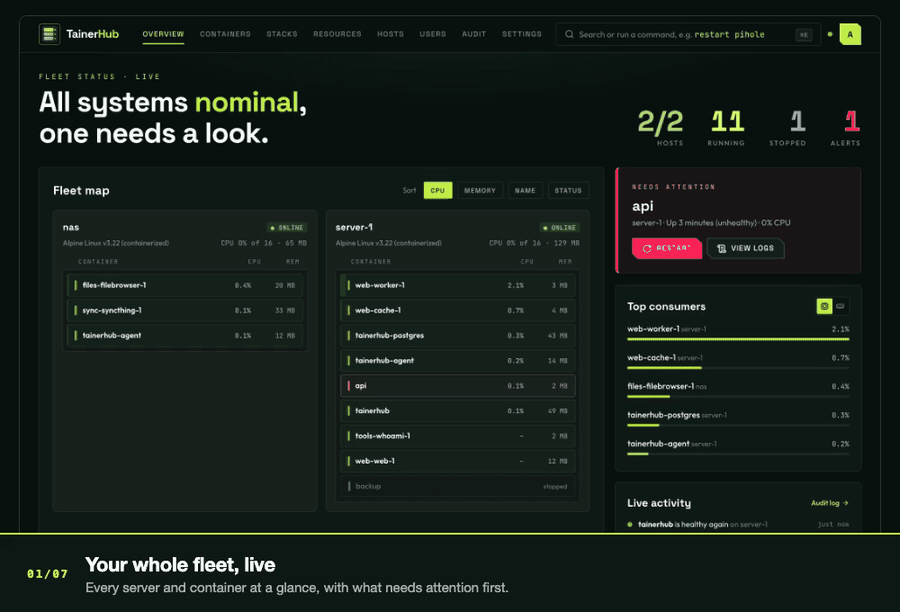</p>
<p align="center"><sub>Prefer video? <a href="docs/images/tour.mp4">Watch the tour as an MP4</a> (0.4 MB).</sub></p>

You run one **hub**. It holds the web UI, the API and a small database. Each Docker server runs a small **agent** that connects out to the hub, so your servers open no ports. From one page you can watch every container, read logs, open a terminal, deploy compose stacks, clean up images and keep TainerHub and Docker itself up to date. It installs with one command, works with a password over plain HTTP on your LAN, and adds HTTPS and passkeys through the reverse proxy you already run.

- [What you can do](#what-you-can-do)
- [How it fits together](#how-it-fits-together)
- [Common setups](#common-setups)
- [Quick start](#quick-start)
- [Guides](#guides)
- [Status](#status)
- [Development](#development)

## What you can do

### See your whole fleet, live

The **Overview** shows every host and container on one map, with what needs attention, the top CPU and memory users, and a live activity feed. Changes are pushed to the browser as they happen.

<p align="center">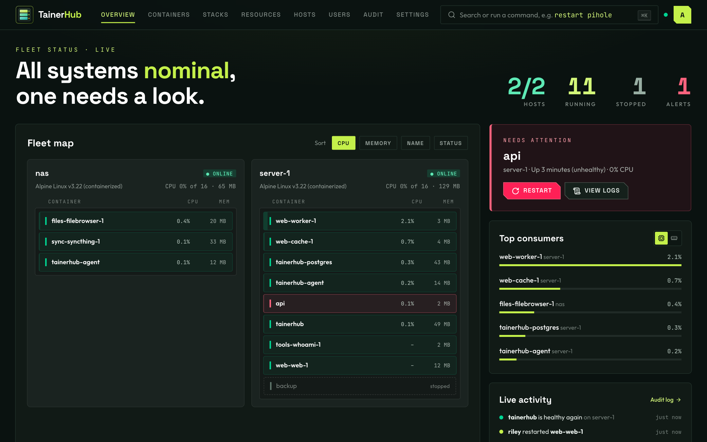</p>

### Manage every container

Start, stop, restart, update and remove containers on any host from one list. Group them by host, stack or state. Open live **logs**, a **terminal** in the browser, or a **details** panel with health-check history, mounts and networks. Move a standalone container to another host, volumes included.

<p align="center">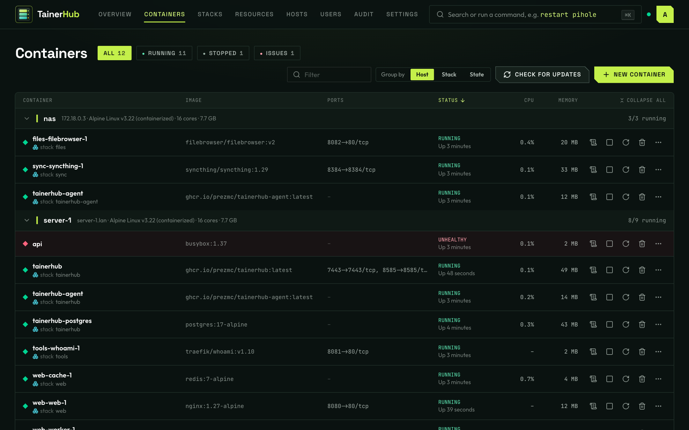</p>

<table>
<tr>
<td width="50%" valign="top">
<h3>Deploy and edit compose stacks</h3>
<p>Paste a compose file, pick a host and deploy. Output streams live while compose pulls and starts. Edit and redeploy later, take over projects you started by hand, or move a stack to another host.</p>
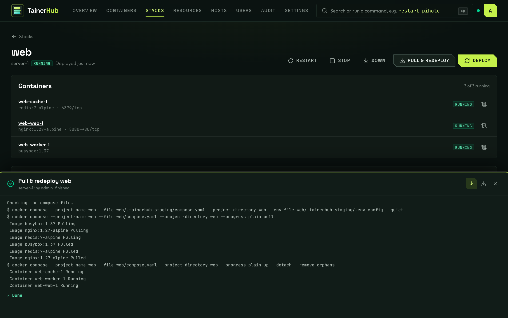
</td>
<td width="50%" valign="top">
<h3>Run new containers from Docker Hub</h3>
<p>Search Docker Hub or use a private registry, then set ports, variables and volumes, plus networks, labels, limits, devices, health checks and more. TainerHub suggests the host with the most room and shows the compose file before it deploys.</p>
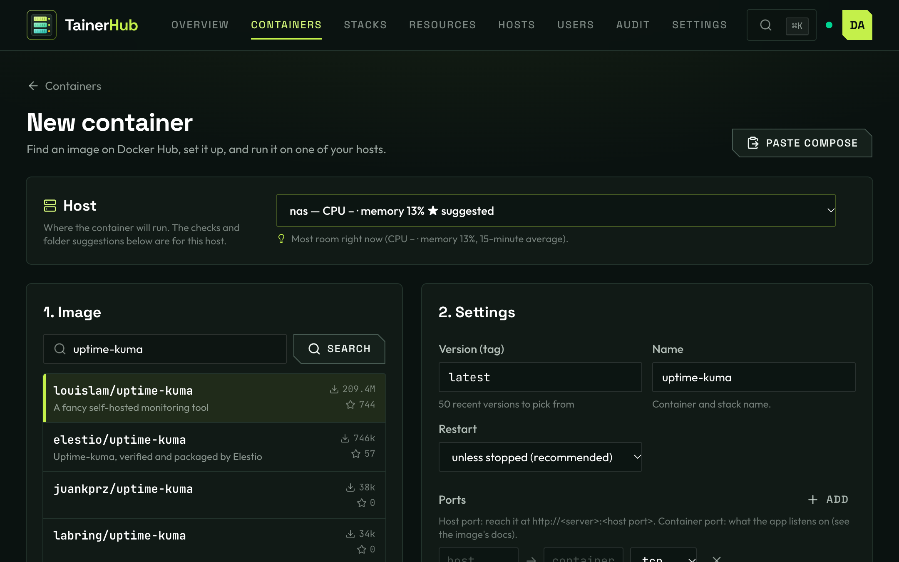
</td>
</tr>
<tr>
<td width="50%" valign="top">
<h3>Images, volumes and networks</h3>
<p>See what's on each host and which containers use it. Pull images, remove what's unused, and prune one host at a time.</p>
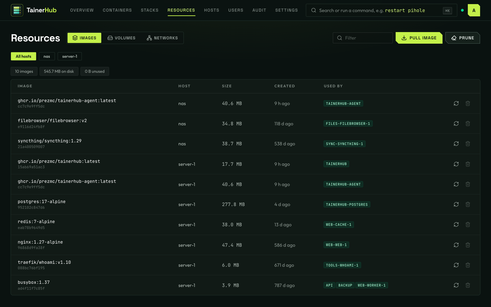
</td>
<td width="50%" valign="top">
<h3>Keep TainerHub and Docker updated</h3>
<p>Update TainerHub on one server or all of them, and upgrade Docker Engine, from the Hosts page. Containers get an <strong>update</strong> badge when a newer image is out.</p>
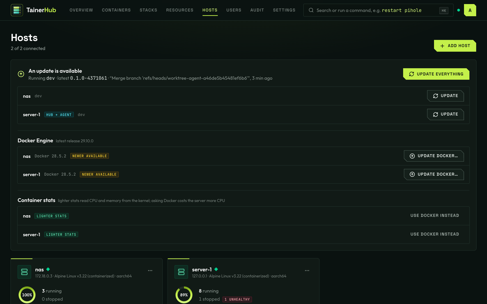
</td>
</tr>
<tr>
<td width="50%" valign="top">
<h3>Users, roles and an audit log</h3>
<p>Invite people as viewer, operator or admin with a one-time link. Secrets stay hidden below admin. The audit log records every sign-in and change.</p>
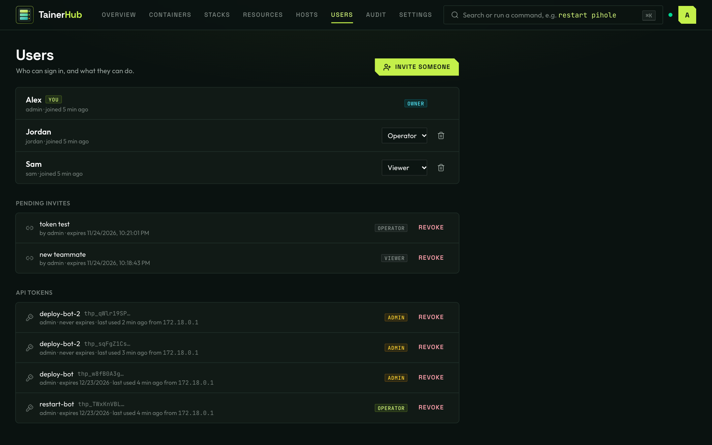
</td>
<td width="50%" valign="top">
<h3>HTTPS and passkeys</h3>
<p>Put TainerHub behind Nginx Proxy Manager from the Settings page. It shows the exact proxy settings and tests them. Then sign in with a passkey.</p>
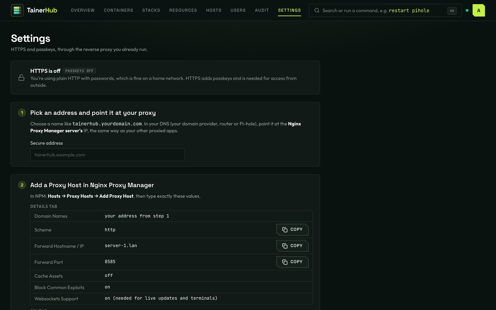
</td>
</tr>
<tr>
<td width="50%" valign="top">
<h3>Command palette</h3>
<p>Press <code>⌘K</code> or <code>Ctrl+K</code> and type <code>restart pihole</code> or <code>logs npm</code>. Jump to any page, container or host.</p>
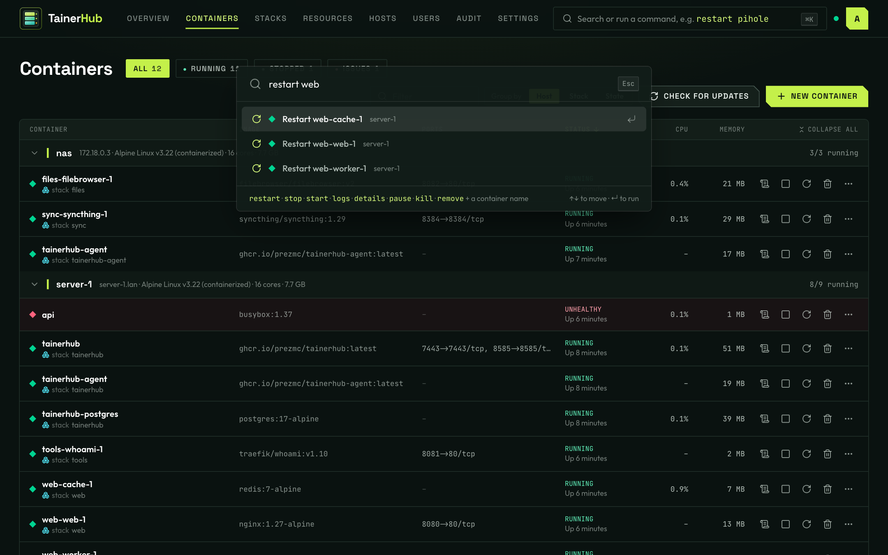
</td>
<td width="50%" valign="top">
<h3>Automate with the API</h3>
<p>Create an API token on your Account page and call the same JSON API the UI uses, from scripts, dashboards or home automation.</p>
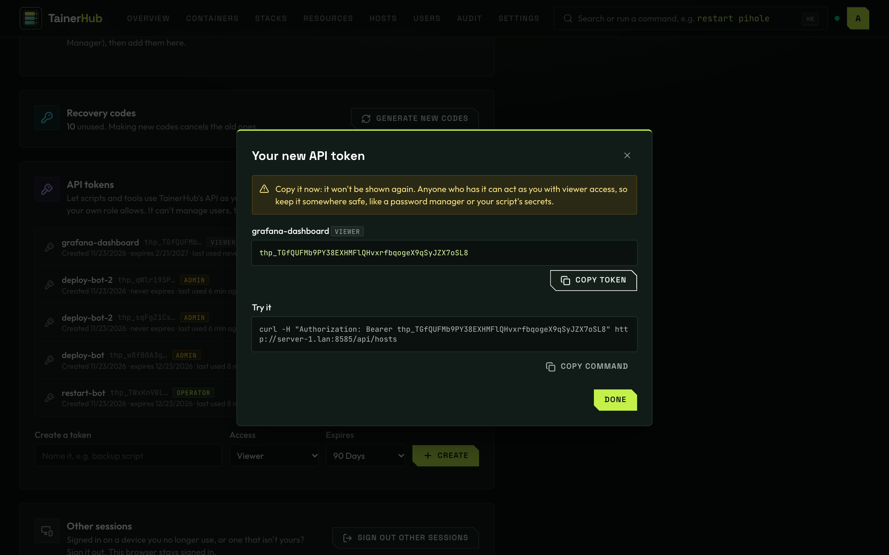
</td>
</tr>
</table>

### Works on your phone

The UI fits a phone screen, so you can check on things and restart a container wherever you can reach the hub.

<p align="center">
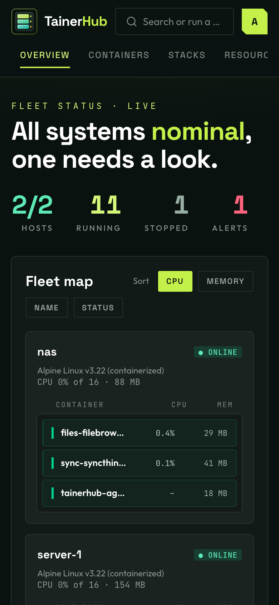
&nbsp;&nbsp;
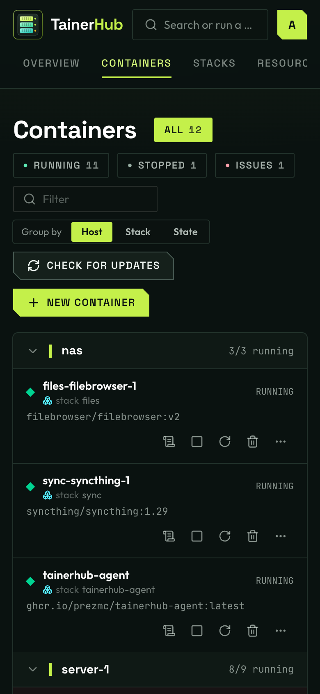
</p>

### Light on your servers

Agents read container CPU and memory from the kernel's cgroup files instead of asking Docker. They sample every 10 seconds while someone has TainerHub open, and once a minute otherwise. The browser gets live pushes instead of polling.

## How it fits together

```
 Browser ──HTTPS 443──> Nginx Proxy Manager ──HTTP──> tainerhub :8585  (UI + /api)
                                                          │
                                                       Postgres
 tainerhub-agent (each server) ──mTLS, HTTP/2──> tainerhub :7443  (agent gateway, never behind a proxy)
        │
   /var/run/docker.sock
```

- **The hub** serves the UI and API on port 8585 and the agent gateway on port 7443. It has no Docker access of its own.
- **Each agent** keeps one long-lived HTTP/2 connection out to port 7443, secured with mutual TLS, and talks to Docker through the socket on its server. It accepts only a fixed list of operations, not raw Docker API calls.
- **Port 7443 must reach the hub directly.** A reverse proxy would end the TLS connection and strip the agents' certificates. Agents trust the hub by its pinned private CA, not by hostname, so they can use an IP, a LAN name or a VPN address.
- **The hub's own server** is managed by an agent in the hub's compose file. That agent is also how TainerHub updates itself.
- **Stacks** are stored in Postgres. On deploy, the agent writes `compose.yaml` and `.env` to `/opt/tainerhub/stacks/<name>/` and runs the `docker compose` binary shipped in its image.

The proxy is optional. Without it, you open `http://<hub IP>:8585` on your LAN.

## Common setups

### One server

Run the [quick start](#quick-start) on it. The hub's built-in agent manages that server, so you're done. Use **New container** on the Containers page, or **Stacks → New stack**, to run things.

### A hub plus a NAS and a Raspberry Pi

Install the hub on your main server, for example `server-1` at `192.168.1.10`. Then, for each other machine, go to **Hosts → Add host**, name it (`nas`, `pi`) and paste the one-line command on that machine. Each one needs Docker with the Compose plugin and must reach the hub on port 7443. Images are built for `amd64` and `arm64`, so a Raspberry Pi needs a 64-bit OS. When you add a stack or a new container, TainerHub suggests the host with the most room. See [Getting started: add your other servers](docs/getting-started.md#4-add-your-other-servers).

### LAN-only, with HTTPS through Nginx Proxy Manager

Keep TainerHub off the internet and still get HTTPS and passkeys. Point `tainerhub.example.com` at your proxy (for example `192.168.1.20`) in your local DNS, add a Proxy Host in NPM, then test and turn on HTTPS in **Settings**. Limit the proxy host with an NPM Access List, or use split DNS. Agents keep connecting to port 7443 directly. See [HTTPS and passkeys](docs/https-and-passkeys.md), in particular [Keeping it LAN-only](docs/https-and-passkeys.md#keeping-it-lan-only).

### Automation with a read-only token

For a dashboard or a monitoring check, create a token with **viewer** access and an expiry under **Account & sign-in → API tokens**. It can read hosts, containers, stacks and logs, but can't change anything:

```bash
curl -s -H "Authorization: Bearer $TOKEN" http://192.168.1.10:8585/api/containers
```

Use an **operator** token for scripts that restart or redeploy. No token can invite users, change roles, create tokens or change how anyone signs in. See the [API guide](docs/api.md).

## Quick start

On a Linux server with Docker and the Compose plugin:

```bash
curl -fsSL https://raw.githubusercontent.com/prezmc/tainerhub/main/install.sh | sh
```

It installs the hub in `~/tainerhub`, then prints the database password (save it) and a one-time setup link. Open the link within 15 minutes and create your owner account. Lost it?

```bash
docker exec tainerhub /tainerhub setup-link
```

To add more servers, go to **Hosts → Add host** and paste the command it gives you on each one. The full walkthrough is in [Getting started](docs/getting-started.md).

## Guides

| Guide | What's in it |
| --- | --- |
| [Getting started](docs/getting-started.md) | Requirements, installing the hub (one line or by hand), first sign-in, adding servers, ports, updating, lighter stats, uninstalling. |
| [Features](docs/features.md) | A tour of every page: Overview, Containers, Stacks, Resources, Hosts, Users and roles, Audit, Settings, Account and API tokens, the command palette, the phone layout. |
| [HTTPS and passkeys](docs/https-and-passkeys.md) | Putting TainerHub behind Nginx Proxy Manager from the Settings page, keeping it LAN-only, and fixing test failures. |
| [Security](docs/security.md) | The security model, API tokens, what TainerHub can't protect against, and a hardening checklist. |
| [API](docs/api.md) | API tokens, calling the JSON API with curl, live event streams, every endpoint with its role, recipes and security notes. |
| [Troubleshooting](docs/troubleshooting.md) | Agent offline, expired join tokens, "Stacks unavailable", passkeys, "Sign in again" prompts, API errors, update errors, high CPU, lost access, logs and profiling. |

## Status

TainerHub is early software. Each green build of `main` is published as `ghcr.io/prezmc/tainerhub:latest` and `ghcr.io/prezmc/tainerhub-agent:latest`, for `linux/amd64` and `linux/arm64`.

Not there yet: `build:` sections in stacks, metrics history and alerts.

## Development

### Repository layout

```
cmd/tainerhub/          hub entry point (also: setup-link, db-password, healthcheck)
cmd/tainerhub-agent/    agent entry point
internal/wire/          hub <-> agent messages and join tokens
internal/pki/           private CA, server and agent certificates
internal/gateway/       agent-facing mTLS endpoint: enrollment, renewal, limits (+ end-to-end test)
internal/registry/      connected agents, in-flight commands and log streams
internal/agent/         agent: enrollment, connection loop, Docker Engine client, stacks, self-update
internal/store/         Postgres store and SQL migrations
internal/auth/          passwords, passkeys, recovery codes, sessions, invites, API tokens
internal/api/           REST API, SSE streams, HTTPS setup, updates; serves the UI
internal/debugsrv/      optional pprof server (TAINERHUB_PPROF_ADDR)
internal/version/       build version
web/                    React + TypeScript UI (Vite, TanStack Router/Query, Tailwind)
deploy/                 compose files for the hub stack and the agent
docs/                   user guides
```

### Building and testing

```bash
make test          # Go tests with the race detector (needs Go 1.26+)
TAINERHUB_REAL_DOCKER=1 DOCKER_SOCKET=/var/run/docker.sock go test ./internal/agent -run Real   # stack lifecycle against a real Docker Engine
make agent         # bin/tainerhub-agent
make hub           # builds the UI, then bin/tainerhub with the UI embedded
make images        # both container images
cd web && npm run dev   # UI on :5173, proxying /api to a hub on :8585
```

To run a hub locally, start Postgres, then:

```bash
TAINERHUB_DATABASE_URL=postgres://... TAINERHUB_DATA_DIR=./data ./bin/tainerhub
```

Add `TAINERHUB_PUBLIC_URL=http://localhost:8585` to try passkeys, which work on `http://localhost` without HTTPS.

Other settings: `TAINERHUB_AUDIT_RETENTION_DAYS` (default `365`; `0` keeps the audit log forever), and `TAINERHUB_PPROF_ADDR=127.0.0.1:6060` to serve Go's profiler (see [Troubleshooting: profiling](docs/troubleshooting.md#profiling-with-pprof)).

Under the hood: agents reconnect with backoff and resend their full state, and keepalives drop dead links within 90 seconds. The UI's JS and CSS are pre-compressed (Brotli and gzip) and cached as immutable, and pages load on demand.

CI runs `govulncheck`, `npm audit` and a Trivy image scan on every push. Images are published with an SBOM and provenance, and `:latest` only moves after the scan passes. See [Security: supply chain](docs/security.md#supply-chain).
