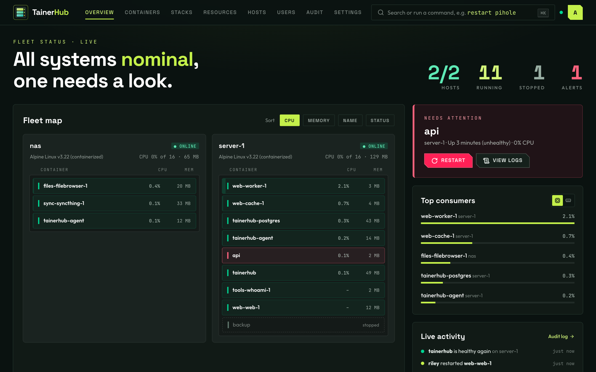
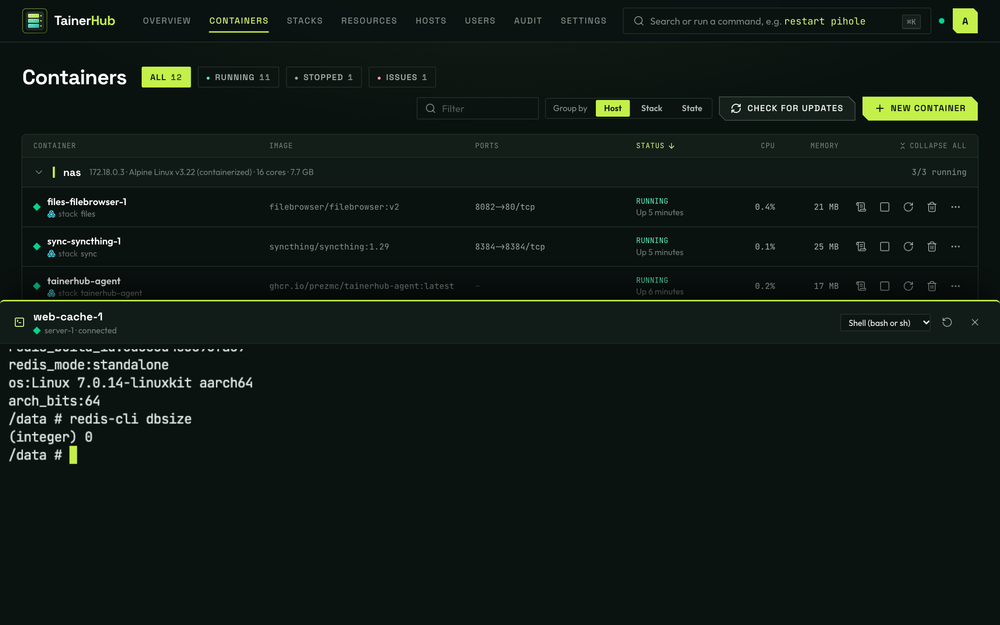
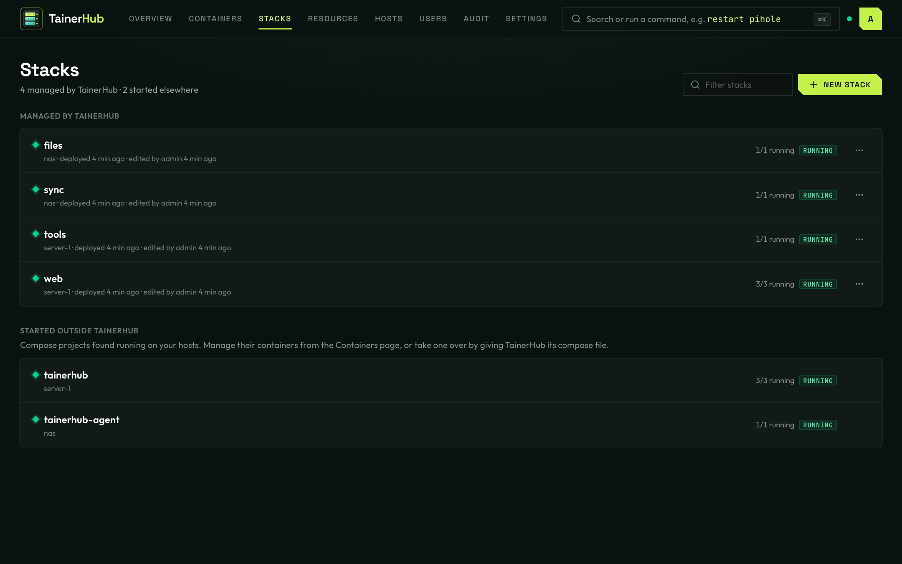
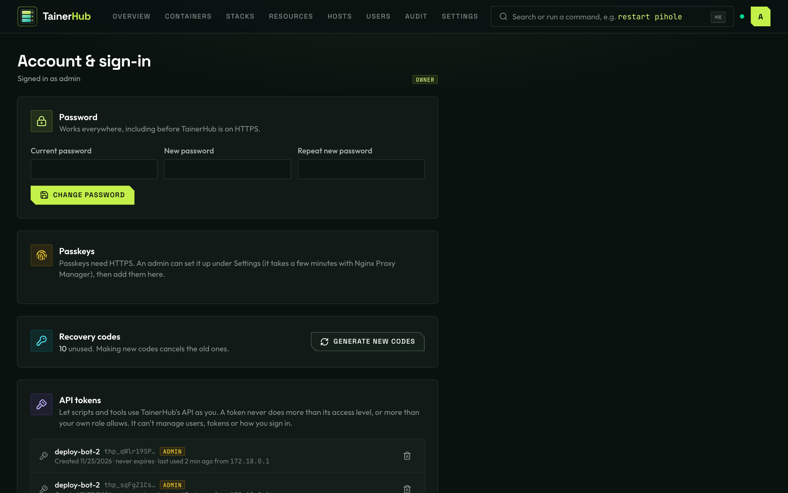
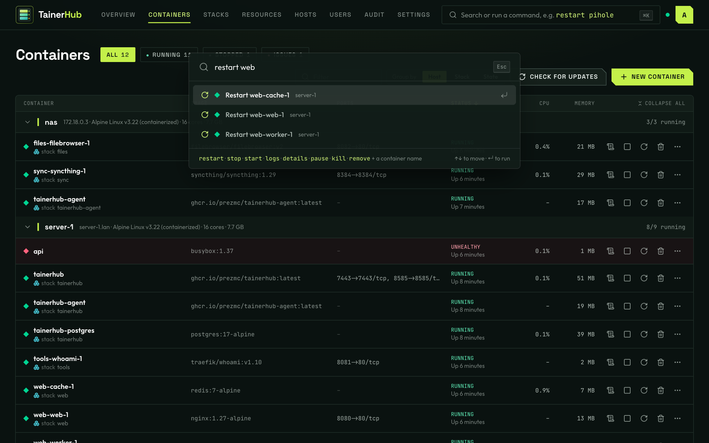

# Features

A tour of every page in TainerHub. The menu across the top has **Overview**, **Containers**, **Stacks**, **Resources** and **Hosts** for everyone. Admins also see **Users**, **Audit** and **Settings**. Your account menu (the badge with your initials, top right) has **Account & sign-in** and **Sign out**.

What you can do on each page depends on your role. See [Users and roles](#users-and-roles) for the full table.

The dot next to the search box shows the live connection to the hub. Green means updates are arriving. Amber means the page is reconnecting.

## Overview

The Overview shows your whole fleet at a glance:

- **Counters** at the top: hosts connected (for example `3/3`), running and stopped containers, and **Alerts** (unhealthy containers plus offline hosts).
- **Fleet map.** One block per host with a tile per container. Sort the tiles by **Status**, **CPU**, **Memory** or **Name**.
- **Needs attention.** Unhealthy containers and offline hosts. When nothing is wrong it says so.
- **Top consumers.** The containers using the most CPU or memory right now. Switch between **By CPU** and **By memory**.
- **Live activity.** Container starts, stops and health changes, and hosts connecting or going offline, as they happen.

## Containers

Every container on every host in one list.

### Filtering, grouping and sorting

- **View buttons**: **All**, **Running**, **Stopped**, **Issues** (unhealthy, restarting, dead, or exited with an error code) and **Updates** (a newer image is available; this button only appears when there is one).
- **Filter** box: matches the container name, image, stack and host.
- **Group by**: **host**, **stack** or **state**. Each group is a section you can fold. **Collapse all** / **Expand all** folds or opens every section.
- **Sort** by clicking the **Container**, **Status**, **CPU** or **Memory** column headings.
- Clicking a host card on the Hosts page opens this list filtered to that host. A **Host:** chip appears; click its `×` to show all hosts again.

Published ports are links. Click one to open `http://<host address>:<port>` in a new tab.

TainerHub remembers your grouping choice in your browser.

### Container actions

Each row has buttons for **Logs**, **Stop** or **Start** (or **Resume** for a paused container), **Restart** and **Remove**. The `…` button (**More actions**) adds:

| Action | What it does |
| --- | --- |
| **Details** | Opens the details panel (see below). |
| **Terminal** | Opens a shell in the container. Admins only, running containers only. |
| **Pause** / **Resume** | Freezes and unfreezes the container's processes. |
| **Kill** | Sends `SIGKILL` at once, with no clean shutdown. |
| **Pull & recreate** | For standalone containers: pulls the newest version of its image and replaces the container with an identical one. If the new one doesn't start, the old one is put back automatically. |
| **Update via its stack** | For containers that belong to a compose project: opens the Stacks page for that project. |
| **Move to another host…** | For standalone containers: recreates it, with its volumes, on another host. Admins only. See [Moving a container to another host](#moving-a-container-to-another-host). |
| **Move with its stack…** | For containers that belong to a compose project: they move with their stack. Admins only. |

Stop, Kill, Remove and Pull & recreate ask you to confirm first.

**Removing a container** deletes it even if it's running. Its image is kept. For operators, its named volumes are kept too. Admins get an extra checkbox to remove the container's volumes at the same time. Volumes that other containers still use are kept, and TainerHub tells you which ones and why.

If a container belongs to a stack, removing it doesn't stop it coming back: redeploying the stack recreates it.

### Moving a container to another host

Admins can move a **standalone container** (one started with `docker run` or another tool, not part of a compose project) to another host: **More actions → Move to another host…**, or **Move…** in its details panel. Containers that belong to a compose project, including those made with **New container**, move with their stack instead (see [Moving a stack to another host](#moving-a-stack-to-another-host)).

Pick the host: each one shows its CPU and memory now and after the move (the container's current use added), and the one with the most room is suggested. TainerHub then checks both hosts and shows what will happen, or what's in the way. The move works like a stack's:

1. Pulls the container's image on the new host while it still runs.
2. Stops it on the old host (if it was running). **It's down from here** until it runs on the new one.
3. Copies its volumes to the new host through the hub, with owners and permissions.
4. Creates it on the new host with the same settings: command, environment, labels, ports, restart policy, resource limits, volumes, networks and so on, exactly as Pull & recreate does. Settings that came from the image are left to the image. A running container is started, and TainerHub waits until it runs and is healthy. A stopped one stays stopped.
5. Removes the old container. **Its volumes stay on the old host** as a backup until you click **Delete old copy** in the container's details panel.

If any step from 2 on fails, TainerHub removes what reached the new host (the container, copied volumes and networks it created) and starts the container on the old host again.

Details:

- **Unnamed volumes** (from the image's `VOLUME` lines, or `-v /path`) are copied too. On the new host they keep their name and the container mounts them by it, so the data comes along.
- **Host folders** (`-v /srv/app:/app`) aren't copied. The dialog lists them; tick that the new host has its own copy at the same paths.
- **Volumes that keep their data elsewhere** (NFS, CIFS, other drivers) aren't copied: the new host must already have a volume of that name.
- **Volumes other containers also use** are copied, and the others keep using the old host's copy, which then isn't offered for deletion.
- **Networks**: Docker's own (`bridge`, `host`, `none`) are used as they are. Other networks the new host already has are joined. A missing bridge network is created with the same settings (and the same address range only if the container has a fixed IP). Other missing networks (overlay, macvlan) block the move: create them on the new host first.
- **The image tag** is pulled again on the new host. If the tag now points to a newer version, the moved container runs that one.

A move can't start when the new host already has a container or volume of that name, a port the container publishes is taken there, or it lacks the disk space. Containers that use another container's network, volumes (`--volumes-from`) or legacy links, or an image without a name, can't be moved. Both hosts need an agent from this version or later. Moves are written to the audit log.

### Image updates

Each agent checks for newer images about 2 minutes after it starts and then every 6 hours. It asks the registry for the current digest of each image tag your containers use and compares it with what's on disk. Containers with a newer image get an **update** badge next to the image name.

Operators can click **Check for updates** to check every online host right away.

To update:

- **Standalone container**: **More actions → Pull & recreate**.
- **Container in a stack**: **Pull & redeploy** on its stack.
- **TainerHub's own containers**: the update card on the Hosts page.

Images pinned by digest (`image@sha256:...`) are never reported as outdated.

### Details panel

Click a container's name, or **More actions → Details**, to open the details panel. It shows:

- **Live CPU and memory**.
- **Overview**: image and image ID, created and started (or exited) times, restart policy (a warning badge if it's `no`), the command, and resource limits or the privileged flag when set.
- **Health check**: current status and recent results, if the container has a health check.
- **Networking**: network mode, networks with their IP addresses, and published ports.
- **Mounts**: volumes and bind mounts, with read-only ones marked.
- **Labels**.
- **Environment**.

Some of this often holds secrets, so only admins see it in full. Everyone else sees:

- environment variable **names**, but not their values,
- label names, but most label **values** hidden (Compose and image labels such as `com.docker.compose.*` and `org.opencontainers.image.*` stay visible),
- the program being run, but not its **arguments** ("arguments hidden for your role"),
- health-check pass/fail and exit codes, but not the check's **output**.

Admins can click **Show values** / **Hide values** in the Environment section.

Press `Esc` to close the panel.

### Logs

**Logs** opens a drawer at the bottom of the screen. It shows the last 500 lines and then follows the log live. You can:

- **Filter lines** by text,
- turn **Wrap** on or off,
- turn **Auto-scroll** on or off,
- **Clear** the view,
- **Download logs** as a file.

Everyone, including viewers, can read logs. Press `Esc` to close the drawer.

### Terminal

Admins can open a terminal into any running container: **More actions → Terminal**. It runs in the browser and goes through the agent's existing connection, so no extra ports are needed.

Choose a shell: **Shell (bash or sh)** tries bash and falls back to sh. You can also pick `sh` or `bash`, or type another command, such as `python3`. Opening a terminal is recorded in the audit log.

Only admins can open terminals, because a shell in a container sees everything it holds, including the environment values that are hidden from other roles.

### New container

Admins can click **New container** to run an image from Docker Hub without writing a compose file:

1. **Image.** Search Docker Hub, for example `nginx`, `plex` or `uptime-kuma`, or type an image name such as `ghcr.io/home-assistant/home-assistant`. Then pick a **Version (tag)**.
2. **Settings.** Pick the **Host**, a **Name** and a **Restart** policy (`unless-stopped` by default). Add **Ports** (host port, container port, tcp or udp), **Environment variables** and **Volumes**. A volume source can be a volume name like `data`, a host folder like `/srv/app`, or `./config` inside the stack's folder.
3. Open **Show the compose file this creates** if you want to see what will run.
4. Click **Deploy**.

The container runs as a one-service stack with the name you chose. You can edit, redeploy or update it later from **Stacks**.

## Stacks

A stack is a compose file that TainerHub deploys to one host. The Stacks page has two lists:

- **Managed by TainerHub**: stacks saved in TainerHub.
- **Started outside TainerHub**: compose projects running on your hosts that TainerHub didn't start.

Each row shows the host, when it was last deployed, who last edited it, how many containers are running, and its status. A **changes not deployed** badge means the saved compose file differs from what's running.

### Creating a stack

Admins: **Stacks → New stack**.

1. Paste your compose file into **compose.yaml**.
2. Add variables to **.env** if your compose file uses them.
3. Pick the **Host**. Hosts are listed with the most room first, with their recent CPU and memory use, and the best one is marked **★ suggested** and chosen for you. Hosts that can't run stacks are marked "(stacks not set up)" or "(offline)".
4. Enter a **Name**: lowercase letters, digits, `-` and `_`, starting with a letter or digit, up to 63 characters.
5. Click **Save & deploy**, or **Save without deploying**.

Limits: the compose file can be up to 256 KB and `.env` up to 64 KB.

### Deploying and running stacks

On a stack's page, operators and admins have:

| Button | What it does |
| --- | --- |
| **Deploy** | Runs `docker compose up -d` with the saved files. |
| **Pull & redeploy** | Pulls newer images, then redeploys. This is how you update a stack's containers. |
| **Restart**, **Stop**, **Start** | Act on the stack's containers. |
| **Down** | Runs `docker compose down`: stops and removes the stack's containers. |

The same actions are in the `…` menu on the Stacks list.

Output streams live into a drawer at the bottom of the screen. A deploy keeps running if you close the tab or the connection drops. Click **View progress** to reopen it. The result goes into the audit log.

When a stack is deployed, the agent writes `compose.yaml` and `.env` to `/opt/tainerhub/stacks/<name>/` on the host and runs the `docker compose` binary that ships inside the agent image. Relative paths such as `./data` in your compose file point into that folder.

### Editing a stack

Admins see the compose file and `.env` on the stack's page, in two tabs. The editor shows who last edited it and how many lines you've changed.

- **Save** keeps your changes without deploying. The stack then shows **changes not deployed**.
- **Save & deploy** saves and deploys at once.
- **Discard** throws away your unsaved changes.

Every deploy checks the new file with `docker compose config` first, so an invalid file never replaces a working one. If two admins edit the same stack at once, the second save is refused with a message to reload, instead of overwriting the first.

Operators and viewers don't see the compose file or `.env`. They often hold passwords, and a compose file can mount the host's disks or run privileged containers. Writing one amounts to root on that host, so only admins can create, edit or delete stacks.

### Deleting a stack

Admins: open the stack and click **Delete…** at the bottom. Type the stack's name to confirm, then choose:

- **Delete stack**: runs `docker compose down` on the host and removes `compose.yaml` and `.env`. Tick **Also delete its named volumes** to delete those too; their data is gone for good. Anything else in the stack's folder, such as bind-mounted data, is left in place.
- **Remove from TainerHub only**: forgets the stack without touching the host. Use this for a host that no longer exists.

### Moving a stack to another host

Admins: open the stack and click **Move…** under **Move to another host**. Pick the host: each one shows its CPU and memory now and after the move (the stack's current use added), and the one with the most room is suggested. TainerHub then checks both hosts and shows what will happen, or what's in the way.

The move:

1. Pulls the stack's images on the new host while the stack still runs. An image that doesn't exist for that host's CPU type stops the move here, before anything changes.
2. Stops the stack on the old host. **It's down from here** until it runs on the new one; the dialog estimates for how long.
3. Copies its named volumes and its folder (`/opt/tainerhub/stacks/<name>/`, which holds relative bind mounts such as `./data`) to the new host. The data goes through the hub; owners and permissions are kept.
4. Deploys it on the new host and waits until every container that ran before runs and is healthy.
5. Makes the new host the stack's host and removes the old containers. **The old copy of the data stays on the old host** as a backup: the stack's page shows it, with **Delete old copy**.

If any step from 2 on fails, TainerHub removes what reached the new host and starts the stack on the old one again. The job's output shows each step.

What isn't copied:

- **Folders outside the stack's folder** (such as `/srv/media:/media`). The dialog lists them; tick that the new host has its own copy at the same paths.
- **External volumes**: the new host must already have a volume of that name.
- **Volumes on NFS, CIFS or a bind** (`driver_opts` in the compose file): their data lives elsewhere, so compose just creates them again on the new host.

A move can't start when the new host already has a stack, project, folder or volume of that name, a port the stack publishes is taken there, or it lacks the disk space. Deploy saved changes before moving, so what moves is what runs. Moves are written to the audit log.

If the hub restarts during a move, the move stops. The stack's page says so: the stack may be stopped on the old host (start it from its buttons) and part of the copy may be on the new one (**Delete partial copy**).

### Taking over projects started elsewhere

Compose projects you started by hand show up under **Started outside TainerHub**. You can manage their containers from the Containers page as usual.

To bring one under TainerHub's control, admins click **Manage in TainerHub** next to it. This opens a new stack with the same name and host, and **TainerHub reads the project's own files** from the folder it was started in (compose records that folder and its files on the containers):

- All its compose files (an override file, say) are merged into one by `docker compose config`, with **relative paths made absolute**: `./data` becomes `/home/you/apps/app/data`. Bind mounts keep pointing at the data where it is, so nothing is copied or moved.
- Variables stay as `${...}`, and its `.env` (or the `--env-file` it was started with) is filled in.
- Files given with `env_file:` are copied into the stack's folder (`env/`), since the agent can only read that folder later on, and the file points at the copies.

Then click **Save & deploy**. When the file matches what runs, compose leaves the containers running as they are.

The file is compose's own tidied-up version: comments and formatting aren't kept, and it uses compose's long form. You can edit it, click **Read again**, or paste your own file instead. To read the files, the agent briefly runs a helper container (its own image, without network) with those folders mounted read-only; system folders such as `/etc` are refused. If the project's containers don't say where it was started (very old compose), paste the file.

If you paste your own file, relative bind mounts such as `./data` point into `/opt/tainerhub/stacks/<name>/`, so **move that data there first**.

While you edit, a **takeover check** compares the file with what the running containers use and lists what would change:

- **Folders that would move**: a bind mount whose host path changes (usually a relative `./…` path). If the new folder is missing or empty it says so and gives the `cp -a` command that copies the data across.
- **Volumes that would be swapped**: a volume whose name changes would be created empty.
- **Services missing from the file**: their containers would be removed.
- **Several compose files**: the project was started with an override file, say, which must be merged into the one you paste. (Not asked when TainerHub read and merged them itself.)
- **Variables that aren't set**: TainerHub runs compose with only the pasted `.env`, not your shell's variables.
- **Problems that stop the deploy**: a `build:` section, or a file compose rejects from the new folder (such as a relative `env_file` that isn't there).

**Save & deploy** stays disabled until there are no blocking problems and you tick that you've dealt with the rest. Changing the files runs the check again and asks again. If you save without deploying, the stack's page shows the same check, with **Deploy and take over**. Only admins can do that first deploy.

You can't create a new stack with the name of a project that is already running on that host. Use **Manage in TainerHub** instead.

### TainerHub protects its own project

TainerHub won't let a stack take the name of the compose project it runs in itself (on the hub's server, that's the project holding the hub, its database and the agent). A stack with that name could remove them. Such projects aren't offered for takeover either.

### Stack limits

- `build:` sections aren't supported. Use images from a registry.
- You can't enter registry credentials in TainerHub yet, so use public images.
- `.env` is stored in plain text in the hub's database. Protect and back up the database like the hub's `/data` volume.

## Resources

Images, volumes and networks across all hosts, in three tabs. Pick a host or show all, and filter by name.

- **Images**: size, created date, and **Used by** (which containers use it). The summary shows the total on disk and how much is unused.
  - Operators can **Pull image** (for example `nginx:1.27` or `ghcr.io/org/app:tag`) onto a host, pull a tag again to update it, and remove images. An image in use can't be removed; remove its containers first.
- **Volumes**: the stack and driver of each one, and which containers use it. Unused volumes are marked **unused**. Only admins can delete volumes. Deleting a volume deletes its data permanently.
- **Networks**: driver, scope, and which containers use each one. Docker's built-in networks can't be removed.

### Prune

The **Prune** menu cleans up one host at a time. You confirm each prune first.

| Tab | Light option | Full option | Who |
| --- | --- | --- | --- |
| Images | **dangling**: untagged layers | **all unused**: every image not used by a container | operators and admins |
| Volumes | **anonymous**: unused anonymous volumes | **all unused**: every unused volume, including named ones | admins only |
| Networks | **unused**: unused networks | — | operators and admins |

The result tells you how many items were removed and how much space was freed.

**All unused** images means the images marked **unused** in the list. Docker's own prune runs first. Some Docker setups prune nothing without saying why, so TainerHub then removes each unused image that's still there one by one, never forcing. If Docker refuses one, the result names it and gives Docker's reason.

## Hosts

One card per server. A card shows:

- the host's name and whether it's connected,
- its address, operating system and CPU architecture,
- a ring with the share of running containers, plus running, stopped and unhealthy counts (click them to jump to the Containers list),
- CPU cores, memory and Docker version,
- bars for CPU and memory use (averaged over the last 15 minutes) and free disk where stacks are kept,
- a **Stacks unavailable** note if the agent can't run stacks, with the reason.

An offline host says **Agent offline. Check docker logs tainerhub-agent on this host.**

Admins have **Add host** (see [Getting started](getting-started.md#4-add-your-other-servers)) and a `…` menu on each card:

- **Rename**: changes only how the host is shown in TainerHub. Nothing changes on the server.
- **New join token**: makes a fresh one-hour, one-time install command, for example if the first one expired.
- **Remove host**: disconnects its agent at once and stops its certificate working. Containers on the host keep running, but the stacks TainerHub saved for it are deleted from TainerHub. To add it back, create the host again and re-run the agent.

### Update card (admins)

At the top of the page, admins see a card with three parts.

**TainerHub updates.** The running version, the latest published version and its description, and when the hub last asked GitHub. It asks every 15 minutes; **Check now** asks right away (at most every 30 seconds) and also refreshes the latest Docker Engine release. When servers are behind, each one is listed with an **Update** button, and **Update everything** updates them all (the hub's server last). See [Keep TainerHub up to date](getting-started.md#6-keep-tainerhub-up-to-date).

**Docker Engine.** Each online host's Docker version, marked **newer available** or **up to date** against the latest Docker Engine release. Click **Update Docker…** (or **Check…**) to open a dialog that:

1. Asks the server how Docker is installed and what its package repository offers. This can take a minute.
2. Shows the version now and after, and how it will upgrade. TainerHub can upgrade Docker installed from Docker's own `apt` or `dnf` repositories, on servers with systemd. For other setups (snap, distribution packages, Docker Desktop, static binaries) it tells you why and shows a command to run yourself, when it has one.
3. Explains what happens: **Docker restarts, so every container on that server stops and starts again**, usually within a minute. Containers without a restart policy stay stopped. If the server runs TainerHub itself, TainerHub is unavailable for a minute or two.
4. Proceeds only after you tick the "I understand…" box and click **Update Docker on &lt;host&gt;**.

The upgrade runs through the server's systemd, outside Docker, and logs to `/var/log/tainerhub-docker-upgrade.log` on the server. The repository may lag behind Docker's newest release; in that case the dialog says the host already has the newest version its repository offers.

**Container stats.** Where each host's CPU and memory numbers come from:

| Badge | Meaning | Button |
| --- | --- | --- |
| **lighter stats** | The agent reads the kernel's cgroup files. Cheapest for the server. | **Use Docker instead** |
| **from Docker (your choice)** | An admin switched this host to Docker's stats. | **Use lighter stats** |
| **from Docker** | The agent doesn't have the cgroup mount. | **Turn on lighter stats** |

Switching between lighter stats and Docker takes effect at once and is remembered across restarts. Use **Use Docker instead** if the lighter numbers ever look wrong. **Turn on lighter stats** adds the missing mount; see [Getting started](getting-started.md#7-turn-on-lighter-stats-older-installs).

Agents sample stats every 10 seconds while someone has TainerHub open, and once a minute otherwise.

## Users and roles

Admins manage users on the **Users** page.

**Inviting someone:**

1. Click **Invite someone**.
2. Pick a role. You can't give out a role higher than your own.
3. Optionally fill in **Who is it for?**, for example "Alex, for the media server".
4. Click **Create invite link**, then **Copy link** and send it however you like.

The link works once, for 24 hours. The person opens it, picks their own username and password (at least 10 characters), and gets their own recovery codes. Unused invites are listed under **Pending invites**, where you can **Revoke** them.

**Changing a role or removing a user:** use the role menu or the remove button on their row. You can only manage users with a lower role than yours, and never your own account. Nobody can change or remove the owner.

### Roles

There are four roles. Each one can do everything the role below it can.

| | Viewer | Operator | Admin | Owner |
| --- | :-: | :-: | :-: | :-: |
| See hosts, containers, stacks, images, volumes, networks | ✓ | ✓ | ✓ | ✓ |
| Read container logs | ✓ | ✓ | ✓ | ✓ |
| Manage their own password, passkeys, recovery codes and sessions | ✓ | ✓ | ✓ | ✓ |
| Start, stop, restart, pause, kill and remove containers | | ✓ | ✓ | ✓ |
| Pull & recreate containers; check for image updates | | ✓ | ✓ | ✓ |
| Deploy, pull & redeploy, start, stop, restart and take down saved stacks | | ✓ | ✓ | ✓ |
| Pull and remove images; remove networks; prune images and networks | | ✓ | ✓ | ✓ |
| See environment values, label values, command arguments and health-check output | | | ✓ | ✓ |
| Read and edit compose files and `.env`; create and delete stacks; take over projects | | | ✓ | ✓ |
| Move stacks and standalone containers to another host | | | ✓ | ✓ |
| New container from Docker Hub | | | ✓ | ✓ |
| Delete volumes; prune volumes; remove a container together with its volumes | | | ✓ | ✓ |
| Open a terminal in a container | | | ✓ | ✓ |
| Add, rename and remove hosts; create join tokens | | | ✓ | ✓ |
| Update TainerHub and Docker Engine; switch container stats source | | | ✓ | ✓ |
| Invite users, change roles, remove users (lower roles only) | | | ✓ | ✓ |
| View the audit log | | | ✓ | ✓ |
| Settings (HTTPS and passkeys) | | | ✓ | ✓ |
| Manage admins | | | | ✓ |

The owner is the account created at setup. There is one owner, and nobody else can change or remove it.

These rules are enforced by the hub's API, not just hidden in the UI.

## Audit log

Admins: **Audit**. Every sign-in and change, newest first, with **When**, **Who**, **Action**, **Target** and **IP**. Use **Filter** to search it. The page shows the most recent 200 entries.

It records, among other things:

- sign-ins (with the method: password, passkey or recovery code) and failed sign-ins,
- password, passkey and recovery-code changes, and "sign out other sessions",
- container and stack actions, with any error,
- stack creation, edits and deletion,
- terminal sessions,
- hosts added, renamed, removed, enrolled and their certificates renewed,
- TainerHub and Docker Engine updates, and stats-source changes,
- users invited, joined, changed and removed,
- HTTPS turned on or off.

Failed sign-ins that hit the rate limit aren't logged, so a flood of attempts can't fill the log.

## Settings

Admins: **Settings**. This page sets up HTTPS and passkeys through a reverse proxy. It shows whether HTTPS is on, whether passkeys are on, and walks you through four steps. See [HTTPS and passkeys](https-and-passkeys.md).

## Account

Everyone: account menu → **Account & sign-in**. It shows your username and role, and has four cards.

- **Password.** Change it with your current password and a new one (at least 10 characters). If you signed up with passkeys only, you can **Set password** to have a second way in. Changing or setting a password signs out your other sessions.
- **Passkeys.** Add a passkey for each device you use: Touch ID, Windows Hello, your phone or a security key. Name it (for example "iPhone") and click **Add**. Passkeys need HTTPS, so this only works at TainerHub's secure address; on the LAN address the card links you there. You can remove a passkey, except your only one when you have no password.
- **Recovery codes.** How many unused codes you have left. It turns red at 3 or fewer. **Generate new codes** makes 10 new ones and cancels the old ones at once.
- **Other sessions.** **Sign out other sessions** signs out every other browser and device. This browser stays signed in.

### The fresh sign-in rule

Adding or removing a passkey, generating new recovery codes, and setting a first password all need a sign-in from **the last 10 minutes**. This stops someone who steals a session cookie from locking you out or adding their own way in. If your sign-in is older, the page shows **Sign in again to continue**. Click **Sign in again**, then try once more.

Changing an existing password doesn't need this, because you type your current password instead.

### Signing in with a recovery code

On the sign-in page, click **Use a recovery code**, enter your username and one code (`XXXX-XXXX-XXXX`), and click **Sign in**. TainerHub takes you to your Account page so you can set a new password or passkey. Each code works once.

## Command palette

Press `⌘K` (Mac), `Ctrl+K` (Windows and Linux) or `/` anywhere, or click the search box at the top. Type to search pages, containers and hosts. Use the arrow keys to move and `Enter` to run. `Esc` closes it.

Start with a verb to act on a container straight away:

| Type | Does |
| --- | --- |
| `restart pihole` | Restarts the container named pihole. |
| `logs npm` | Opens npm's logs. |
| `stop mosquitto` | Stops mosquitto. |
| `stop server-2/mosquitto` | Stops mosquitto on server-2, when several hosts have one. |
| `details grafana` | Opens grafana's details panel. |

The verbs are `start`, `stop`, `restart`, `pause`, `unpause`, `kill`, `remove`, `logs` and `details`. Matching uses the host name, container name and image. Actions that change things ask for confirmation just like the buttons do, and need the operator role. Viewers can use `logs` and `details`.
