# Features

A tour of every page in TainerHub. The menu across the top has **Overview**, **Containers**, **Stacks**, **Resources** and **Hosts** for everyone. Admins also see **Users**, **Audit** and **Settings**. Your account menu (the badge with your initials, top right) has **Account & sign-in** and **Sign out**.

What you can do on each page depends on your role. See [Users and roles](#users-and-roles) for the full table.

Scripts and tools can do the same through the API, with an [API token](#api-tokens). On a phone, see [Phone layout](#phone-layout).

The dot next to the search box shows the live connection to the hub. Green means updates are arriving. Amber means the page is reconnecting.

## Overview

The Overview shows your whole fleet at a glance:

- **Counters** at the top: hosts connected (for example `3/3`), running and stopped containers, and **Alerts** (unhealthy containers plus offline hosts).
- **Fleet map.** One block per host with a tile per container. Sort the tiles by **Status**, **CPU**, **Memory** or **Name**.
- **Needs attention.** Unhealthy containers and offline hosts. When nothing is wrong it says so.
- **Top consumers.** The containers using the most CPU or memory right now. Switch between **By CPU** and **By memory**.
- **Live activity.** Container starts, stops and health changes, and hosts connecting or going offline, as they happen.

## Containers

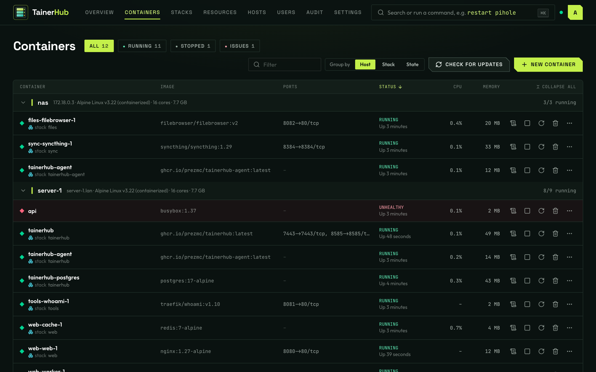

Every container on every host in one list.

### Filtering, grouping and sorting

- **View buttons**: **All**, **Running**, **Stopped**, **Issues** (unhealthy, restarting, dead, or exited with an error code) and **Updates** (a newer image is available; this button only appears when there is one).
- **Filter** box: matches the container name, image, stack and host.
- **Group by**: **host**, **stack** or **state**. Each group is a section you can fold. **Collapse all** / **Expand all** folds or opens every section.
- **Sort** by clicking the **Container**, **Status**, **CPU** or **Memory** column headings.
- Clicking a host card on the Hosts page opens this list filtered to that host. A **Host:** chip appears; click its `×` to show all hosts again.

Published ports are links. Click one to open `http://<host address>:<port>` in a new tab.

TainerHub remembers your grouping choice in your browser.

### Container actions

Each row has buttons for **Logs**, **Stop** or **Start** (or **Resume** for a paused container), **Restart** and **Remove**. The `…` button (**More actions**) adds:

| Action | What it does |
| --- | --- |
| **Details** | Opens the details panel (see below). |
| **Terminal** | Opens a shell in the container. Admins only, running containers only. |
| **Pause** / **Resume** | Freezes and unfreezes the container's processes. |
| **Kill** | Sends `SIGKILL` at once, with no clean shutdown. |
| **Pull & recreate** | For standalone containers: pulls the newest version of its image and replaces the container with an identical one. If the new one doesn't start, the old one is put back automatically. |
| **Update via its stack** | For containers that belong to a compose project: opens the Stacks page for that project. |
| **Move to another host…** | For standalone containers: recreates it, with its volumes, on another host. Admins only. See [Moving a container to another host](#moving-a-container-to-another-host). |
| **Move with its stack…** | For containers that belong to a compose project: they move with their stack. Admins only. |

Stop, Kill, Remove and Pull & recreate ask you to confirm first.

**Removing a container** deletes it even if it's running. Its image is kept. For operators, its named volumes are kept too. Admins get an extra checkbox to remove the container's volumes at the same time. Volumes that other containers still use are kept, and TainerHub tells you which ones and why.

If a container belongs to a stack, removing it doesn't stop it coming back: redeploying the stack recreates it.

### Moving a container to another host

Admins can move a **standalone container** (one started with `docker run` or another tool, not part of a compose project) to another host: **More actions → Move to another host…**, or **Move…** in its details panel. Containers that belong to a compose project, including those made with **New container**, move with their stack instead (see [Moving a stack to another host](#moving-a-stack-to-another-host)).

Pick the host: each one shows its CPU and memory now and after the move (the container's current use added), and the one with the most room is suggested. TainerHub then checks both hosts and shows what will happen, or what's in the way. The move works like a stack's:

1. Pulls the container's image on the new host while it still runs.
2. Stops it on the old host (if it was running). **It's down from here** until it runs on the new one.
3. Copies its volumes to the new host through the hub, with owners and permissions.
4. Creates it on the new host with the same settings: command, environment, labels, ports, restart policy, resource limits, volumes, networks and so on, exactly as Pull & recreate does. Settings that came from the image are left to the image. A running container is started, and TainerHub waits until it runs and is healthy. A stopped one stays stopped.
5. Removes the old container. **Its volumes stay on the old host** as a backup until you click **Delete old copy** in the container's details panel.

If any step from 2 on fails, TainerHub removes what reached the new host (the container, copied volumes and networks it created) and starts the container on the old host again.

Details:

- **Unnamed volumes** (from the image's `VOLUME` lines, or `-v /path`) are copied too. On the new host they keep their name and the container mounts them by it, so the data comes along.
- **Host folders** (`-v /srv/app:/app`) aren't copied. The dialog lists them; tick that the new host has its own copy at the same paths.
- **Volumes that keep their data elsewhere** (NFS, CIFS, other drivers) aren't copied: the new host must already have a volume of that name.
- **Volumes other containers also use** are copied, and the others keep using the old host's copy, which then isn't offered for deletion.
- **Networks**: Docker's own (`bridge`, `host`, `none`) are used as they are. Other networks the new host already has are joined. A missing bridge network is created with the same settings (and the same address range only if the container has a fixed IP). Other missing networks (overlay, macvlan) block the move: create them on the new host first.
- **The image tag** is pulled again on the new host. If the tag now points to a newer version, the moved container runs that one.

A move can't start when the new host already has a container or volume of that name, a port the container publishes is taken there, or it lacks the disk space. Containers that use another container's network, volumes (`--volumes-from`) or legacy links, or an image without a name, can't be moved. Both hosts need an agent from this version or later. Moves are written to the audit log.

### Image updates

The hub has each host check for newer images 2–3 minutes after its agent connects and then every 6 hours (set `TAINERHUB_UPDATE_CHECK_HOURS` on the hub; `0` turns this off). Hosts are spread out so a large fleet doesn't hit the registries all at once. The agent asks the registry for the current digest of each image tag your containers use and compares it with the image each container runs. Containers on an older image get an **update** badge next to the image name. Because each container is compared on its own, two stacks that share an image (say `postgres:16`) each show their own answer: updating one doesn't hide the other's update, and neither does pulling the image without recreating the container. The badge goes away as soon as the container runs the newer image (after **Pull & redeploy**, **Pull & recreate** or an automatic update), without waiting for the next check. Automatic updates use the same per-container answer.

Operators can click **Check for updates** to check every online host right away; hovering over it shows when the hosts were last checked.

Agents also check on their own every 6 hours, without registry logins, for hubs that don't schedule checks. They skip it when the hub has checked in the last 5 hours.

To update:

- **Standalone container**: **More actions → Pull & recreate**.
- **Container in a stack**: **Pull & redeploy** on its stack.
- **TainerHub's own containers**: the update card on the Hosts page.

Images pinned by digest (`image@sha256:...`) are never reported as outdated.

To have this done for you at night, see [Automatic updates](#automatic-updates).

### Automatic updates

Automatic updates are off until an admin turns them on for a stack or a container, one at a time:

- **A stack**: the **Automatic updates** switch on the stack's page (managed stacks only).
- **A standalone container**: the same switch in its details panel. A container that belongs to a compose project can't be turned on by itself, because its stack's containers update together: turn it on for the stack (take the project over first if it was started outside TainerHub).

Opted-in stacks show an **auto** badge in the Stacks list.

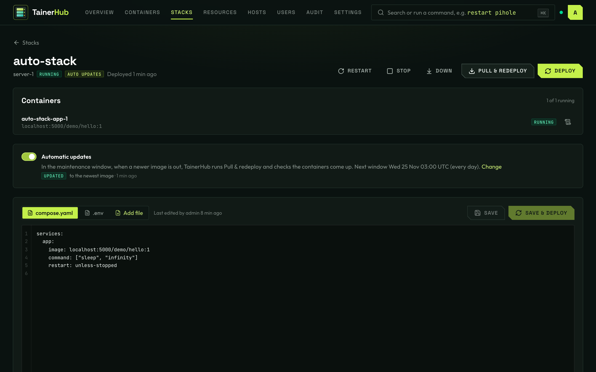

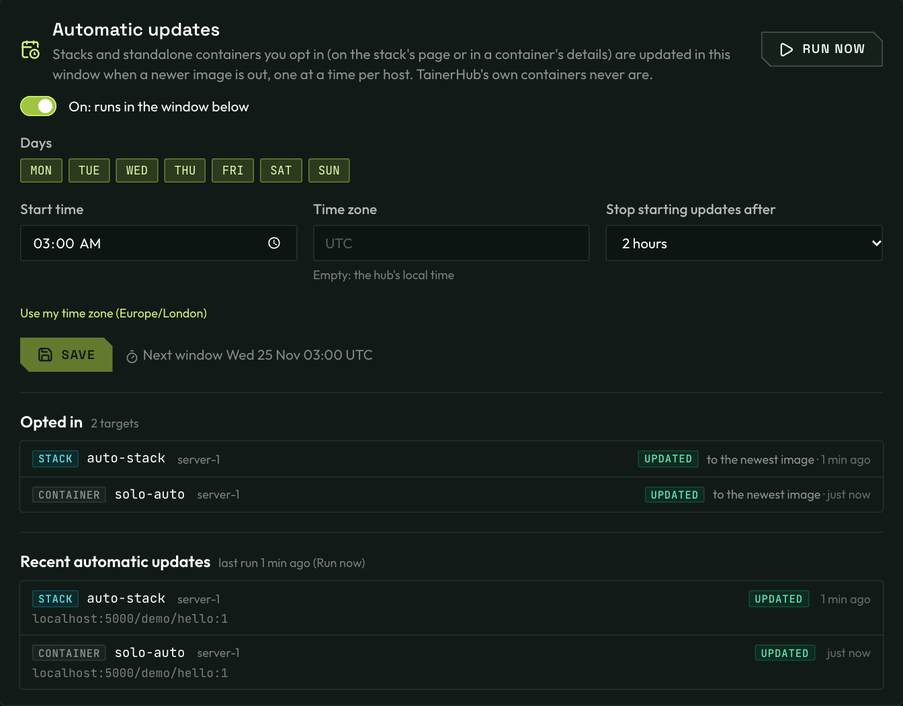

**When.** Under **Settings → Automatic updates** you choose the days, a start time and a time zone (empty means the hub's local time, which is often UTC inside a container; **Use my time zone** fills in your browser's), and how long the window lasts (2 hours by default). The default is every day at 03:00. The switch at the top pauses every scheduled window without forgetting what was opted in. **Run now** runs the whole procedure straight away, even while paused.

**What happens in a window.**

1. For each host with opted-in targets, the hub runs a fresh image update check with the saved registry logins (waiting for a check that is already running there rather than starting a second one).
2. A container is updated when its image has a newer version. A stack is updated when any image its containers run, or that its compose file names, has a newer version.
3. An update is the same thing you'd click: a stack gets **Pull & redeploy** (a job by "Automatic updates" you can open from the stack's page), a container gets **Pull & recreate** (which puts the old container back if the new one won't start).
4. The hub then waits up to 2 minutes for the containers to be running, and healthy if they have a health check (a one-off service that exited with code 0, such as a migration step, counts as fine; a container that was stopped is recreated stopped and not waited for).
5. If a stack's Pull & redeploy fails, or its containers don't come up healthy in time, and **Roll back automatically if the update fails** is ticked (under the stack's switch; on by default), the hub [rolls the stack back](#rolling-back-a-stack) right away to the images it ran before the update. The stack then stays on those images, and later windows skip it until someone uses **Return to latest**. With the box unticked, the update is just marked **failed**. A container's **Pull & recreate** already puts the old container back when the new one won't start; that outcome is shown as **rolled back** too. A container that starts but isn't healthy in time is marked **failed**: its old container is gone by then.
6. The outcome (**ok**, **rolled back**, **failed** with the error, or **skipped** with the reason) is kept on the target, listed under **Recent automatic updates** in Settings (a rolled-back stack links to the rollback's output), and shown under the switch. Every update tried is written to the audit log (actor `automatic updates`, actions `update.auto_applied`, `update.auto_rolled_back` and `update.auto_failed`, with the images and, for containers, the old and new image IDs) and to the live activity feed.

Hosts are worked through in parallel, at most 4 at a time; the targets on one host are updated one after the other. When the window's time is up, targets not reached yet are skipped and left for the next window.

**Safety rules.**

- Nothing is updated unless an admin opted it in. Turning a target on or off, changing the window and **Run now** need a recent sign-in, and API tokens can't do them. Each is audited.
- TainerHub's own containers and compose project (the hub, its database, the agents, anything named `tainerhub…`) are never updated automatically: use the update card on the Hosts page.
- A target is skipped, not forced, when its host is offline, a job is already running for it (a deploy, a move), or (for stacks) it has saved changes that haven't been deployed, since Pull & redeploy would deploy those too. Stacks never deployed by TainerHub are skipped as well, and so are stacks that run a rollback (someone, or a failed update, went back to older images on purpose).
- Images pinned by digest never have a newer version, so such containers can't be opted in.

**Stacks that build images.** A service with `build:` makes its own image, which has no registry digest to compare, so TainerHub can't tell whether its base image changed. A stack that builds is updated only when one of its pulled images has a newer version (Pull & redeploy then also rebuilds with `--pull`, refreshing the base images). Otherwise it's skipped as "builds". Redeploy it yourself when you know a base image changed.

The hub reads `image:` lines from the compose file without evaluating variables, so an image written as `${REGISTRY}/app:1` only counts through the containers running it.

### Details panel

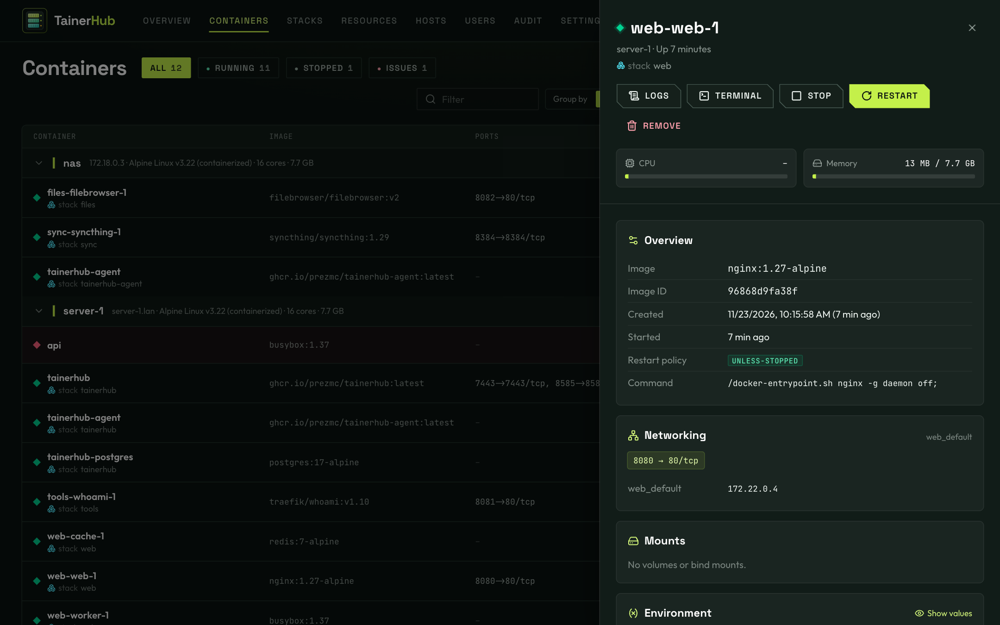

Click a container's name, or **More actions → Details**, to open the details panel. It shows:

- **Live CPU and memory**.
- **Overview**: image and image ID, created and started (or exited) times, restart policy (a warning badge if it's `no`), the command, and resource limits or the privileged flag when set.
- **Health check**: current status and recent results, if the container has a health check.
- **Networking**: network mode, networks with their IP addresses, and published ports.
- **Mounts**: volumes and bind mounts, with read-only ones marked.
- **Labels**.
- **Environment**.

Some of this often holds secrets, so only admins see it in full. Everyone else sees:

- environment variable **names**, but not their values,
- label names, but most label **values** hidden (Compose and image labels such as `com.docker.compose.*` and `org.opencontainers.image.*` stay visible),
- the program being run, but not its **arguments** ("arguments hidden for your role"),
- health-check pass/fail and exit codes, but not the check's **output**.

Admins can click **Show values** / **Hide values** in the Environment section.

Press `Esc` to close the panel.

### Logs

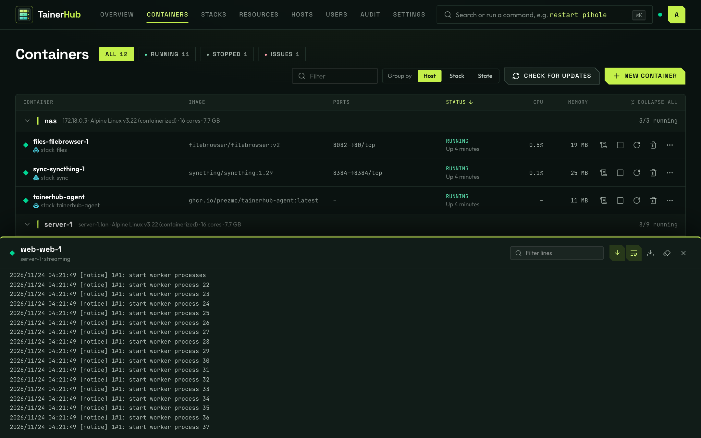

**Logs** opens a drawer at the bottom of the screen. It shows the last 500 lines and then follows the log live. You can:

- **Filter lines** by text,
- turn **Wrap** on or off,
- turn **Auto-scroll** on or off,
- **Clear** the view,
- **Download logs** as a file.

Everyone, including viewers, can read logs. Press `Esc` to close the drawer.

Each person can have up to 4 log streams open per host and 8 in all, across tabs and scripts. The next one fails with "you have too many log streams open"; close a logs drawer or a tab you no longer need. All users together can have up to 16 open per host.

### Terminal

Admins can open a terminal into any running container: **More actions → Terminal**. It runs in the browser and goes through the agent's existing connection, so no extra ports are needed.

Choose a shell: **Shell (bash or sh)** tries bash and falls back to sh. You can also pick `sh` or `bash`, or type another command, such as `python3`. Opening a terminal is recorded in the audit log.

Only admins can open terminals, because a shell in a container sees everything it holds, including the environment values that are hidden from other roles.

### New container

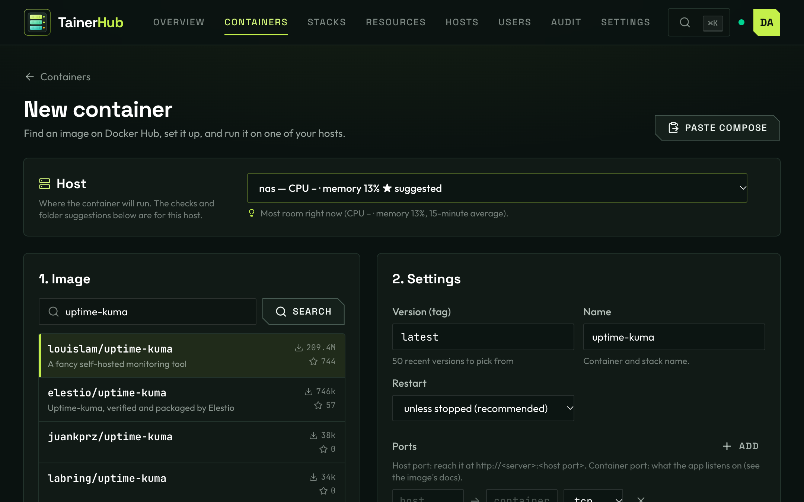

Admins can click **New container** on the Containers page to run an image from Docker Hub without writing a compose file:

1. **Host.** The row at the top of the page shows where the container will run. Hosts are listed with their recent CPU and memory use, and the one with the most room is marked **★ suggested** and chosen for you. Pick the host first: the checks and the folder suggestions when you paste a compose file are for this host, and **Deploy** says which host it deploys to.
2. **Image.** Search Docker Hub, for example `nginx`, `plex` or `uptime-kuma`, or type an image name such as `ghcr.io/home-assistant/home-assistant`. Then pick a **Version (tag)**, or include it in the name you type (`...:stable`). Images from private registries work once their login is saved under Settings → Container registries.
3. **Settings.** Pick a **Name** and a **Restart** policy (`unless-stopped` by default). Add **Ports** (host port, container port, tcp or udp), **Environment variables** and **Volumes**. A host port another container on the host already publishes is flagged right away, with **Use** *next free port*. If `TZ` is set to UTC (`Etc/UTC`, the usual example value), it offers this computer's time zone. A volume source can be a volume name like `data`, a host folder like `/srv/app`, or `./config` inside the stack's folder.
4. **Advanced** (optional, collapsed until you need it):
   - **Networking:** network mode (default, host or none), join existing networks on the host or create a new one, hostname, extra hosts (`host-gateway` reaches the Docker host) and DNS servers.
   - **Labels:** for example Traefik's `traefik.enable=true` and router rules.
   - **Command & runtime:** command and entrypoint overrides (quotes are respected), working directory, user (`1000:1000`), an init process, a read-only root filesystem, a stop grace period and the time zone.
   - **Resources:** memory and CPU limits, shared memory, devices (like `/dev/dri`) and all NVIDIA GPUs.
   - **Health check:** the image's own, a custom command with its timings, or none.
   - **Security:** add or drop Linux capabilities, no-new-privileges, and privileged mode (full root access to the host; it asks you to confirm).
   - **Logging:** cap the log size, for example 10 MB × 3 files.
   - **Env file:** paste `KEY=value` lines; they're saved as the stack's `.env`.
5. Check the **Compose file** preview: it's exactly what will be deployed.
6. Read the **Checks on** *host* panel (see [Checks before deploying](#checks-before-deploying)), then click **Deploy to** *host*.

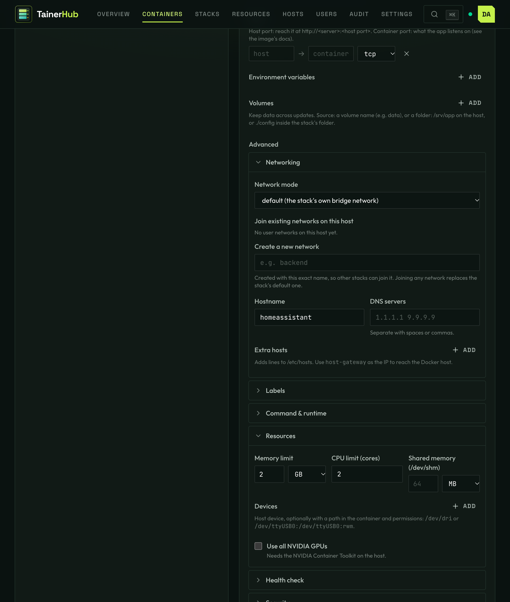

The container runs as a one-service stack with the name you chose. You can edit, redeploy or update it later from **Stacks**.

#### Paste a compose file

Many projects publish a `docker-compose.yml` snippet in their README (Uptime Kuma, Home Assistant, Jellyfin and so on). Instead of copying it field by field, click **Paste compose** at the top of the page (or **Paste it** under the search box) and paste the snippet:

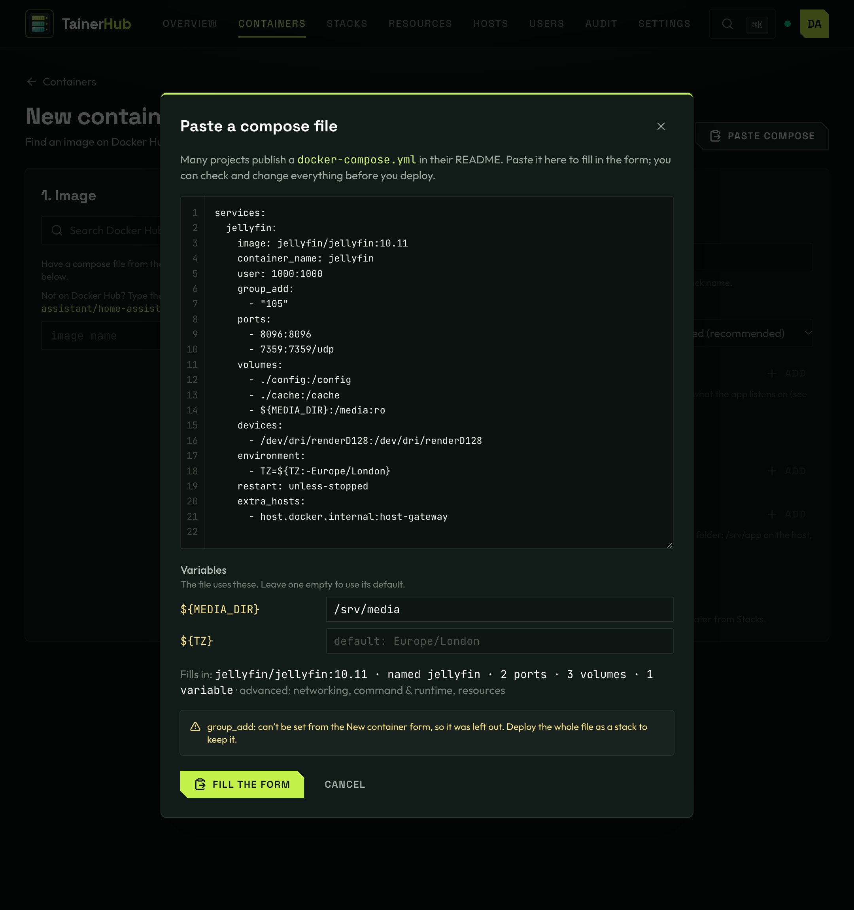

- **Variables.** Every `${VAR}` the file uses without a default is listed under **Variables to fill in**. One left empty stays empty and is flagged. Variables with a default (`${TZ:-UTC}`) are listed under **Changed for you**, showing the default they'll use, with a box to set your own. `$$` is a literal `$`.
- **Changed for you.** Whenever TainerHub fills in a value or changes one to fit the form, it's listed with what the file had, what it'll be and why, with a box or menu to set it differently. That covers variable defaults, `latest` when the file names no version, `unless-stopped` when it sets no restart policy, `on-failure` when the file limits the retries, a name made valid (`My_App` becomes `my_app`), a `CMD` health check run through the shell, missing log limits, and limits converted to MB. Two of them are recommendations you can turn down with **Keep**: `TZ=Etc/UTC` (or `${TZ:-UTC}`) becomes this computer's time zone, as the browser reports it, and a host port already in use on the chosen host becomes the next free one (the port inside the container stays the same). **Fill the form** accepts them as shown, and the notice above **Settings** lists them again afterwards.
- **Examples from the docs.** READMEs often use sample values meant to be replaced, like `/path/to/prowlarr/data:/config`, `/PATH_TO_YOUR_CONFIG`, `PASSWORD=changeme` or `` Host(`<your-domain>`) ``. Deployed as they are, Docker would create the example folder empty on the host, owned by root, and the app would run with the sample value. **Replace the examples** lists each one with a box for your own value. For a volume, it recommends a folder and fills it in:
  - **Following the host's layout:** TainerHub looks at the folders the host's other containers use. If `sonarr` keeps `/config` in `/srv/appdata/sonarr/config` and `radarr` in `/srv/appdata/radarr/config`, Prowlarr's recommended folder is `/srv/appdata/prowlarr/config`. A folder another container already uses is never recommended.
  - **The stack's own folder**, such as `/opt/tainerhub/stacks/prowlarr/config` (written `./config` in the compose file). TainerHub creates it, and it moves with the stack. This is the recommendation when the host has no pattern to follow, and always offered as the other choice.

  Each choice says why it's suggested, and you can click the other one or type your own folder. The dialog says which host it is using: the one picked at the top of the page, so pick the host first. For a password, secret, token or key, **Generate** fills in a random 32-character value. Anything you leave as it was stays flagged.
- **Several services.** A container runs one service, so you pick which one. Or click **Deploy all as a stack**: the stack editor opens with the file exactly as you pasted it, a suggested name (the file's `name:`, else its first service) and a `.env` with the values you typed.
- **What it fills in.** The image and tag, name (`container_name`, else the service name), restart policy, ports (including udp, ranges and the long syntax), volumes and binds (`:ro` is kept), environment, networks (`external: true` ones are joined, one other is created), labels, command and entrypoint, hostname, extra hosts, DNS, user, working directory, init, read-only, stop grace period, memory, CPU and shared-memory limits, devices, NVIDIA GPUs (`deploy.resources.reservations`, `gpus:` or `runtime: nvidia`), health check, `cap_add`/`cap_drop`, privileged, no-new-privileges and json-file log limits. Advanced sections that got values open by themselves.
- **What it can't.** Anything the form has no field for is listed as a warning, never dropped silently: `depends_on`, `build:`, other services, `env_file` (paste its lines under **Env file**), external volumes, ports published on one address only (like `127.0.0.1:9000:9000`), capabilities outside the form's list, Swarm `deploy` settings and other keys. If those matter, deploy the whole file as a stack instead.

**Fill the form** replaces what's in the form. The warnings stay above **Settings** until you dismiss them, and nothing is deployed until you click **Deploy**. The pasted file is read in your browser, and every value goes through the same checks and quoting as values you type. Only the form's own compose file goes to the host, to be checked and deployed.

#### Checks before deploying

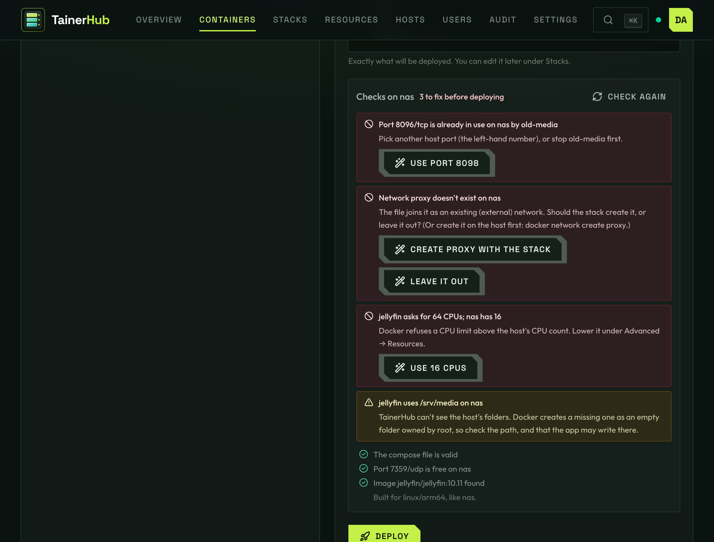

Once the settings are complete, TainerHub checks them against the host you picked, and checks again as you change them. Nothing on the host changes. It checks:

- **The compose file:** Docker Compose on the host resolves it as it would for the deploy, so anything it would reject shows up now.
- **Names:** no stack, compose project or container on the host has the same name.
- **Ports:** no other container on the host publishes the same host port, and the file doesn't publish one twice. Containers on the host network can't be checked, so they're flagged.
- **The image:** the tag exists in its registry, with a build for the host's CPU (amd64, arm64, arm/v7, …). Private images use the logins under Settings → Container registries. An image the host already has can still start without the registry.
- **Networks and volumes** the file expects to exist already (`external: true`).
- **Limits and hardware:** a CPU limit above the host's CPU count (Docker refuses it), a memory limit above its memory, and a GPU when Docker on the host isn't set up for NVIDIA GPUs.
- **Examples from the docs:** a host folder that still looks like a sample (`/path/to/…`, `<…>`, `your…`) is red, with a **Use ./config** button. Environment values that look like samples (`changeme`, `<your-domain>`) are yellow, with **Generate a value** for passwords and secrets. Only the variable names reach the hub, not their values.
- **Things it can't see:** host folders outside the stack's folder and devices like `/dev/dri` are listed so you can check them yourself. Docker creates a missing folder as an empty one owned by root.

Problems that would stop the deploy are red, and **Deploy** refuses to start until they're fixed. Yellow ones are worth a look but don't stop it, and green ones passed. Where there's an obvious fix, a button applies it to the form: **Use port 8097** (the next free port), **Use** *name***-2**, **Use 16 CPUs**, **Turn the GPU off**, or a tag of the image that has a build for the host's CPU (Docker Hub images only; a tag from the same series first, then `latest`, then other versions). Where it can't guess, it says what to decide: a missing network can be created with the stack or left out. After a fix, a line under the checks says what it changed in the form, with **Undo** to put the form back as it was. Click **Check again** after changing something on the host.

Hosts whose agent is older than this check only get the compose file checked; update the agent for the rest.

## Stacks

A stack is a compose file that TainerHub deploys to one host. The Stacks page has two lists:

- **Managed by TainerHub**: stacks saved in TainerHub.
- **Started outside TainerHub**: compose projects running on your hosts that TainerHub didn't start.

Each row shows the host, when it was last deployed, who last edited it, how many containers are running, and its status. A **changes not deployed** badge means the saved compose file differs from what's running.

### Creating a stack

Admins: **Stacks → New stack**.

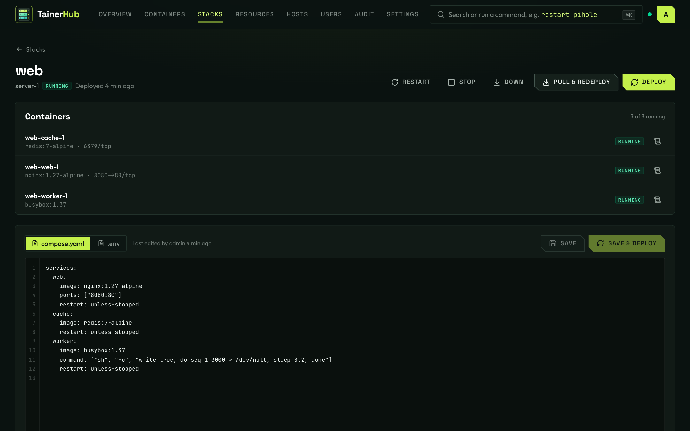

1. Paste your compose file into **compose.yaml**.
2. Add variables to **.env** if your compose file uses them.
3. Pick the **Host**. Hosts are listed with the most room first, with their recent CPU and memory use, and the best one is marked **★ suggested** and chosen for you. Hosts that can't run stacks are marked "(stacks not set up)" or "(offline)".
4. Enter a **Name**: lowercase letters, digits, `-` and `_`, starting with a letter or digit, up to 63 characters.
5. The same [checks](#checks-before-deploying) as New container run against the host, with their suggestions as text. **Save & deploy** waits until nothing red is left; **Save without deploying** always works.
6. Click **Save & deploy**, or **Save without deploying**.

Limits: the compose file can be up to 256 KB and `.env` up to 64 KB.

### Other files: Dockerfiles, scripts, config

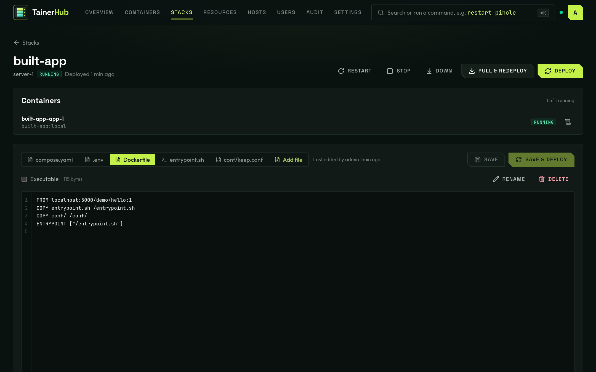

A stack can carry more files than `compose.yaml` and `.env`: a `Dockerfile`, an `entrypoint.sh`, an `nginx.conf`, a `requirements.txt`. Click **Add file** next to the editor's tabs, type a name (folders are fine: `conf/nginx.conf`) or start from a template (**Dockerfile**, **entrypoint.sh**, **Empty file**). Each file gets its own tab, with **Rename**, **Delete** and an **Executable** box for scripts.

The files are stored in TainerHub's database with the stack and written next to `compose.yaml` on every deploy, so `build: .`, `COPY entrypoint.sh /` and `./nginx.conf:/etc/nginx/nginx.conf:ro` work as they would in a folder of your own. TainerHub keeps a list of the files it wrote (`.tainerhub-files`): a file you delete from the stack is removed from the host on the next deploy, while anything else in the folder, such as data, is never touched. TainerHub refuses to write through a symbolic link.

Limits: up to 30 files, each up to 256 KB and 2 MB together, text only (UTF-8). Names use letters, digits, `.`, `_` and `-`, at most 3 folders deep; `compose.yaml`, `.env` and names starting with `.tainerhub` are taken.

### Building images

When a service has a `build:` section, **Deploy** runs `docker compose up -d --build`, which rebuilds what changed (the build cache keeps that quick). **Pull & redeploy** runs `docker compose build --pull` (newer base images), then `docker compose pull --ignore-buildable` for the other services, then `up -d`. The build log streams into the same drawer as any deploy.

- Builds use Docker's classic builder (the agent image has no buildx). Plain Dockerfiles work; BuildKit-only syntax such as `RUN --mount=...` or `COPY --link` doesn't.
- Private base images (`FROM ghcr.io/you/base`) get the login saved under Settings → Container registries, like `image:` lines. TainerHub reads the `FROM` lines of files named `Dockerfile`, `*.Dockerfile` or `Dockerfile.*`, or named by `dockerfile:` in the compose file, filling in `ARG` defaults.
- A Git repository works as a build context: `build: https://github.com/org/repo.git#main` (or `context:` with that URL). Docker fetches it on the host; private repositories aren't supported.
- Images built on the host have no registry digest, so they never show an "update available" badge. Use **Pull & redeploy** to rebuild on newer base images.

### Deploying and running stacks

On a stack's page, operators and admins have:

| Button | What it does |
| --- | --- |
| **Deploy** | Runs `docker compose up -d` with the saved files (with `--build` when a service builds its image). |
| **Pull & redeploy** | Pulls newer images (and rebuilds on newer base images), then redeploys. This is how you update a stack's containers. |
| **Roll back** | Puts every service back on the image it ran before the last deploy, update or rollback. See [Rolling back a stack](#rolling-back-a-stack). |
| **Restart**, **Stop**, **Start** | Act on the stack's containers. |
| **Down** | Runs `docker compose down`: stops and removes the stack's containers. |

The same actions are in the `…` menu on the Stacks list.

Output streams live into a drawer at the bottom of the screen. A deploy keeps running if you close the tab or the connection drops. Click **View progress** to reopen it. The result goes into the audit log.

When a stack is deployed, the agent writes `compose.yaml`, `.env` and the stack's other files to `/opt/tainerhub/stacks/<name>/` on the host and runs the `docker compose` binary that ships inside the agent image. Relative paths such as `./data` in your compose file point into that folder.

### Rolling back a stack

Right before every **Deploy**, **Pull & redeploy**, automatic update and rollback, TainerHub records which image each of the stack's services runs: the image name, its ID and its registry digest. That's a rollback point; each stack keeps its last 5. Nothing is recorded while the stack isn't running (there's nothing to go back to), and the job's output says whether a point was recorded.

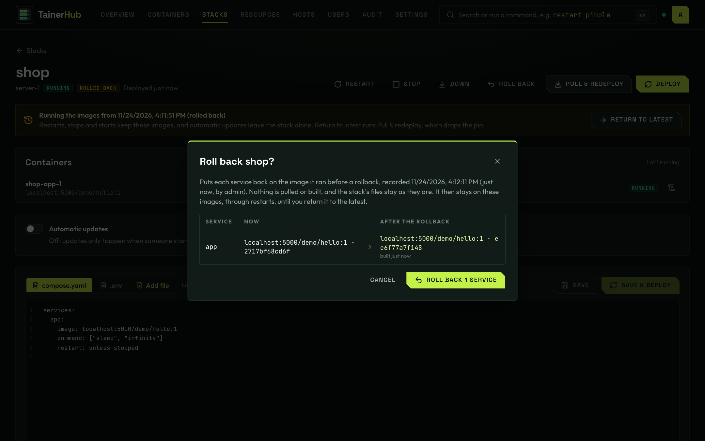

**Roll back** on the stack's page (operators and admins) opens a preview: for each service, the image it runs now and the one it would go back to, with when and before what the point was recorded. Confirming runs a job like a deploy, with its output in the drawer:

1. The agent checks that every old image is still on the host. If one is gone, the rollback stops before changing anything.
2. It pins each service to its old image with an extra compose file, `.tainerhub-rollback.yaml` in the stack's folder (with `pull_policy: never`), and runs `docker compose up -d --remove-orphans` with it. Nothing is pulled or built, and the stack's own files, `.env` and its deployed version don't change: a rolled-back stack doesn't show **changes not deployed**. A service the compose file no longer has is skipped.

The stack then stays **pinned**: the page shows *Running the images from &lt;time&gt; (rolled back)*, and **Restart**, **Stop**, **Start** and **Down** keep using the old images, so containers never flip back by surprise. **Return to latest** on that banner runs **Pull & redeploy**; any deploy runs without the pin and removes it once it worked. Rolling back again goes back one more step: to what ran before the rollback, which undoes it. The audit log records each rollback as `stack.rolled_back`, with the images.

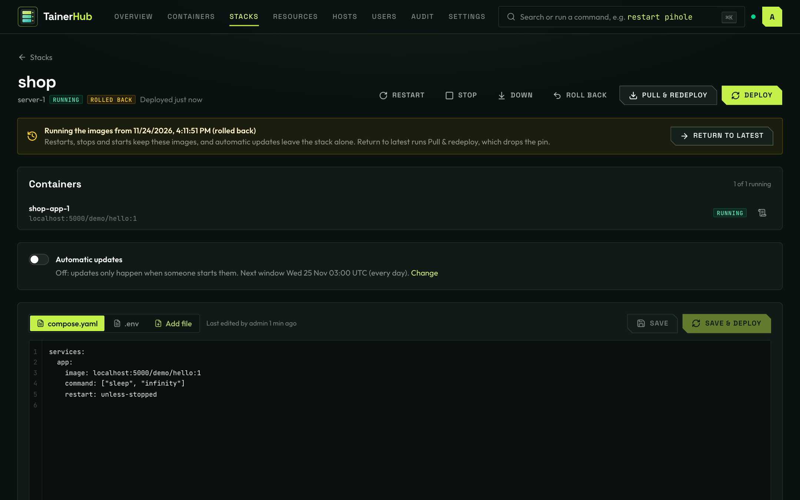

**Keeping the old images.** A rollback needs the old images, so the agent tags the newest point's images `tainerhub-rollback/<stack>:<service>` (and a rolled-back stack's images `tainerhub-rollback/<stack>/pinned:<service>`). TainerHub's own prunes leave those images alone, and Resources shows them as **kept for rollback of &lt;stack&gt;**; only an admin can remove one, after a warning. Deleting the stack drops its tags. A `docker image prune -a` run outside TainerHub doesn't know about them and can still remove the images; the next rollback then fails with "the previous image is gone" and changes nothing.

**Limits.** A rollback changes images only: if the compose file was deployed again since the point was recorded, the rest of the current file stays (the preview warns about it). Data the new version changed (database migrations, say) isn't rolled back. Moving a stack to another host clears its rollback points, since the old images are on the old host.

### Editing a stack

Admins see the compose file, `.env` and the stack's other files on the stack's page, one tab each. The editor shows who last edited it and how many lines you've changed.

- **Save** keeps your changes without deploying. The stack then shows **changes not deployed**.
- **Save & deploy** saves and deploys at once.
- **Discard** throws away your unsaved changes.

Every deploy checks the new file with `docker compose config` first, so an invalid file never replaces a working one. If two admins edit the same stack at once, the second save is refused with a message to reload, instead of overwriting the first.

Operators and viewers don't see the compose file, `.env` or the other files. They often hold passwords, and a compose file can mount the host's disks or run privileged containers. Writing one amounts to root on that host, so only admins can create, edit or delete stacks.

### Deleting a stack

Admins: open the stack and click **Delete…** at the bottom. Type the stack's name to confirm, then choose:

- **Delete stack**: runs `docker compose down` on the host and removes `compose.yaml`, `.env` and the files TainerHub wrote. Tick **Also delete its named volumes** to delete those too; their data is gone for good. Anything else in the stack's folder, such as bind-mounted data, is left in place.
- **Remove from TainerHub only**: forgets the stack without touching the host. Use this for a host that no longer exists.

### Moving a stack to another host

Admins: open the stack and click **Move…** under **Move to another host**. Pick the host: each one shows its CPU and memory now and after the move (the stack's current use added), and the one with the most room is suggested. TainerHub then checks both hosts and shows what will happen, or what's in the way.

The move:

1. Pulls the stack's images on the new host while the stack still runs. An image that doesn't exist for that host's CPU type stops the move here, before anything changes.
2. Stops the stack on the old host. **It's down from here** until it runs on the new one; the dialog estimates for how long.
3. Copies its named volumes and its folder (`/opt/tainerhub/stacks/<name>/`, which holds relative bind mounts such as `./data`) to the new host. The data goes through the hub; owners and permissions are kept.
4. Deploys it on the new host, with the stack's files from TainerHub's database, and waits until every container that ran before runs and is healthy. A service that builds its image is built there during this step (its image isn't pulled in step 1), so the downtime includes the build.
5. Makes the new host the stack's host and removes the old containers. **The old copy of the data stays on the old host** as a backup: the stack's page shows it, with **Delete old copy**.

If any step from 2 on fails, TainerHub removes what reached the new host and starts the stack on the old one again. The job's output shows each step.

What isn't copied:

- **Folders outside the stack's folder** (such as `/srv/media:/media`). The dialog lists them; tick that the new host has its own copy at the same paths.
- **External volumes**: the new host must already have a volume of that name.
- **Volumes on NFS, CIFS or a bind** (`driver_opts` in the compose file): their data lives elsewhere, so compose just creates them again on the new host.

A move can't start when the new host already has a stack, project, folder or volume of that name, a port the stack publishes is taken there, or it lacks the disk space. Deploy saved changes before moving, so what moves is what runs. Moves are written to the audit log.

If the hub restarts during a move, the move stops. The stack's page says so: the stack may be stopped on the old host (start it from its buttons) and part of the copy may be on the new one (**Delete partial copy**).

### Taking over projects started elsewhere

Compose projects you started by hand show up under **Started outside TainerHub**. You can manage their containers from the Containers page as usual.

To bring one under TainerHub's control, admins click **Manage in TainerHub** next to it. This opens a new stack with the same name and host, and **TainerHub reads the project's own files** from the folder it was started in (compose records that folder and its files on the containers):

- All its compose files (an override file, say) are merged into one by `docker compose config`, with **relative paths made absolute**: `./data` becomes `/home/you/apps/app/data`. Bind mounts keep pointing at the data where it is, so nothing is copied or moved.
- Variables stay as `${...}`, and its `.env` (or the `--env-file` it was started with) is filled in.
- Files given with `env_file:` are copied into the stack's folder (`env/`), since the agent can only read that folder later on, and the file points at the copies.

Then click **Save & deploy**. When the file matches what runs, compose leaves the containers running as they are.

The file is compose's own tidied-up version: comments and formatting aren't kept, and it uses compose's long form. You can edit it, click **Read again**, or paste your own file instead. To read the files, the agent briefly runs a helper container (its own image, without network) with those folders mounted read-only; system folders such as `/etc` are refused. If the project's containers don't say where it was started (very old compose), paste the file.

If you paste your own file, relative bind mounts such as `./data` point into `/opt/tainerhub/stacks/<name>/`, so **move that data there first**.

While you edit, a **takeover check** compares the file with what the running containers use and lists what would change:

- **Folders that would move**: a bind mount whose host path changes (usually a relative `./…` path). If the new folder is missing or empty it says so and gives the `cp -a` command that copies the data across.
- **Volumes that would be swapped**: a volume whose name changes would be created empty.
- **Services missing from the file**: their containers would be removed.
- **Several compose files**: the project was started with an override file, say, which must be merged into the one you paste. (Not asked when TainerHub read and merged them itself.)
- **Variables that aren't set**: TainerHub runs compose with only the pasted `.env`, not your shell's variables.
- **Services that build their image**: TainerHub builds them from the stack's own files, so add the Dockerfile and what it copies with **Add file** first.
- **Problems that stop the deploy**: a file compose rejects from the new folder (such as a relative `env_file` that isn't there).

**Save & deploy** stays disabled until there are no blocking problems and you tick that you've dealt with the rest. Changing the files runs the check again and asks again. If you save without deploying, the stack's page shows the same check, with **Deploy and take over**. Only admins can do that first deploy.

You can't create a new stack with the name of a project that is already running on that host. Use **Manage in TainerHub** instead.

### TainerHub protects its own project

TainerHub won't let a stack take the name of the compose project it runs in itself (on the hub's server, that's the project holding the hub, its database and the agent). A stack with that name could remove them. Such projects aren't offered for takeover either.

### Stack limits

- Builds use Docker's classic builder: no BuildKit-only Dockerfile syntax, and no private Git repositories as build contexts.
- Private images need a login saved under Settings → Container registries (see below).
- `.env` is stored in plain text in the hub's database. Protect and back up the database like the hub's `/data` volume.

### Private registries

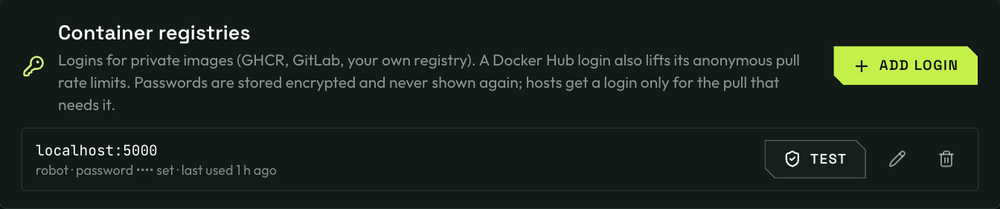

Admins save logins under **Settings → Container registries**: the registry's address (`ghcr.io`, `registry.gitlab.com`, `docker.io`, `myregistry.lan:5000`), a username and a password or access token. For GHCR, use a personal access token with `read:packages`. A Docker Hub login also lifts Docker Hub's anonymous pull rate limits.

- Passwords are encrypted (AES-256-GCM) with a key the hub creates in its data folder (`/data/registry.key`), so a database backup alone doesn't reveal them. Back up `/data` with the database: without the key, saved passwords have to be entered again.
- No page or API shows a saved password again. Changing a login needs a recent sign-in; API tokens can't.
- A host gets a login only inside the command that pulls from that registry (pulling an image, deploying a stack, Pull & recreate, checking for updates, updating TainerHub) and keeps nothing. For stacks, the hub reads the compose file's `image:` lines to pick the registries.
- **Test** has an online host's Docker log in with the saved login, without saving it there.
- Scheduled update checks carry the logins too, so private images get update badges without clicking **Check for updates**. An agent's own fallback check has no logins: for private images it keeps the last answer instead of clearing it.

## Resources

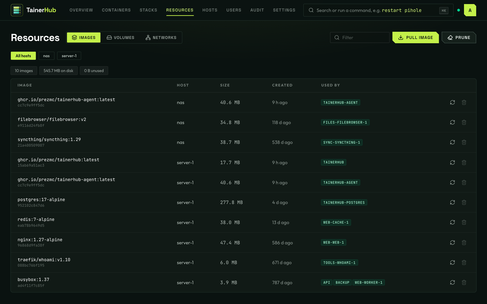

Images, volumes and networks across all hosts, in three tabs. Pick a host or show all, and filter by name.

- **Images**: size, created date, and **Used by** (which containers use it). The summary shows the total on disk and how much is unused. Images kept so a stack can [roll back](#rolling-back-a-stack) to them show **kept for rollback of &lt;stack&gt;**.
  - Operators can **Pull image** (for example `nginx:1.27` or `ghcr.io/org/app:tag`) onto a host, pull a tag again to update it, and remove images. An image in use can't be removed; remove its containers first. An image kept for a rollback can only be removed by an admin, after a warning (the stack can't roll back to it afterwards).
- **Volumes**: the stack and driver of each one, and which containers use it. Unused volumes are marked **unused**. Only admins can delete volumes. Deleting a volume deletes its data permanently.
- **Networks**: driver, scope, and which containers use each one. Docker's built-in networks can't be removed.

### Prune

The **Prune** menu cleans up one host at a time. You confirm each prune first.

| Tab | Light option | Full option | Who |
| --- | --- | --- | --- |
| Images | **dangling**: untagged layers | **all unused**: every image not used by a container | operators and admins |
| Volumes | **anonymous**: unused anonymous volumes | **all unused**: every unused volume, including named ones | admins only |
| Networks | **unused**: unused networks | — | operators and admins |

The result tells you how many items were removed and how much space was freed.

**All unused** images means the images marked **unused** in the list, except those kept for a stack's rollback (the result lists them as kept). Docker's own prune runs first, unless there are images kept for a rollback: it can't be told to spare them, so then only the one-by-one pass below runs. Some Docker setups prune nothing without saying why, so TainerHub then removes each unused image that's still there one by one, never forcing. If Docker refuses one, the result names it and gives Docker's reason.

## Hosts

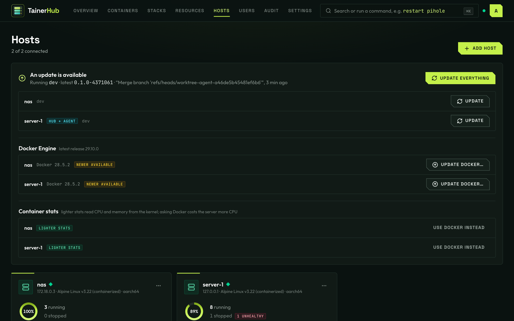

One card per server. A card shows:

- the host's name and whether it's connected,
- its address, operating system and CPU architecture,
- a ring with the share of running containers, plus running, stopped and unhealthy counts (click them to jump to the Containers list),
- CPU cores, memory and Docker version,
- bars for CPU and memory use (averaged over the last 15 minutes) and free disk where stacks are kept,
- a **Stacks unavailable** note if the agent can't run stacks, with the reason.

An offline host says **Agent offline. Check docker logs tainerhub-agent on this host.**

Admins have **Add host** (see [Getting started](getting-started.md#4-add-your-other-servers)) and a `…` menu on each card. Adding a host and making a new join token need a [recent sign-in](#the-fresh-sign-in-rule).

- **Rename**: changes only how the host is shown in TainerHub. Nothing changes on the server.
- **New join token**: makes a fresh one-hour, one-time install command, for example if the first one expired.
- **Remove host**: disconnects its agent at once and stops its certificate working. Containers on the host keep running, but the stacks TainerHub saved for it are deleted from TainerHub. To add it back, create the host again and re-run the agent.

### Update card (admins)

At the top of the page, admins see a card with four parts.

**TainerHub updates.** The running version, the latest published version and its description, and when the hub last asked GitHub. It asks every 15 minutes; **Check now** asks right away (at most every 30 seconds) and also refreshes the latest Docker Engine release. When servers are behind, each one is listed with an **Update** button, and **Update everything** updates them all (the hub's server last). See [Keep TainerHub up to date](getting-started.md#6-keep-tainerhub-up-to-date).

**Docker Engine.** Each online host's Docker version, next to the latest Docker Engine release. What a host can install comes from its package repository, which often gets a release a while after Docker publishes it, so each host is marked by what its repository offered when TainerHub last asked:

| Status | Meaning | Button |
| --- | --- | --- |
| **29.10.1 available** | The repository has a newer version. | **Update Docker…** |
| **up to date** · "29.10.1 released, not in apt yet" | Docker released a newer version, but the repository doesn't have it yet. | **Check…** |
| "29.10.1 released; check what this server's repository offers" | Docker released a newer version and TainerHub hasn't asked this host's repository yet (or can't, for snap and distribution packages). | **Check…** |
| **up to date** | Nothing newer. | **Check…** |
| **repository off** | No repository on the server offers Docker, usually because an OS release upgrade turned Docker's source off. **Check…** shows the command that fixes it. | **Check…** |

TainerHub asks a host's repository only when you open the dialog, and remembers the answer for 12 hours, until the host's Docker version or the latest release changes, or until the hub restarts. Click **Update Docker…** (or **Check…**) to open a dialog that:

1. Asks the server how Docker is installed and what its package repository offers. This can take a minute.
2. Shows the version now and after, and how it will upgrade. TainerHub can upgrade Docker installed from Docker's own `apt` or `dnf` repositories, on servers with systemd. For other setups (snap, distribution packages, Docker Desktop, static binaries) it tells you why and shows a command to run yourself, when it has one.
3. Explains what happens: **Docker restarts, so every container on that server stops and starts again**, usually within a minute. Containers without a restart policy stay stopped. If the server runs TainerHub itself, TainerHub is unavailable for a minute or two.
4. Proceeds only after you tick the "I understand…" box and click **Update Docker on &lt;host&gt;**.

The upgrade runs through the server's systemd, outside Docker, and logs to `/var/log/tainerhub-docker-upgrade.log` on the server. If the repository doesn't have Docker's newest release yet, the dialog says the host already has the newest version its repository offers, and the host's status changes to match.

**Operating system.** The OS package updates each online host's package manager (`apt`, `dnf` or `yum`) would install. Click **Check** on a host, or **Check all**: the host refreshes its package lists and simulates an upgrade. Nothing is installed. Each host then shows:

- **N updates**, with how many are **security** updates. **Packages** lists each one, from and to which version, and where it comes from.
- **reboot needed** when the server asks for a reboot (on Debian and Ubuntu, `/var/run/reboot-required`; on Fedora and RHEL, `needs-restarting -r` when installed). Hover to see which packages asked for it.
- **couldn't refresh** when `apt-get update` (or `dnf check-update`) failed, with apt's own message: for example, a repository the server can't reach. The list may then be out of date.

- **installing** while TainerHub installs updates there, and a red line when the last install failed, with the package manager's error.

TainerHub keeps each host's answer until the next check or a hub restart, and doesn't check on its own.

**Install updates…** installs everything the check listed. The dialog shows the packages, and the host checks again before it starts. Then `apt-get upgrade --with-new-pkgs` (or `dnf upgrade`, `yum update`) runs through the server's systemd, keeping config files you've changed, and logs to `/var/log/tainerhub-os-upgrade.log` on the server. The row shows **installing** until it's done, then checks again on its own.

- **Containers keep running**, unless the updates include Docker or containerd. Then the dialog warns that every container on the server restarts, and asks you to tick "I understand…" first, as for a Docker update.
- Services that use updated libraries keep the old ones until they restart (on Ubuntu, `needrestart` only lists them).
- **TainerHub doesn't reboot.** A new kernel takes effect after you reboot the server yourself; the host then stops showing **reboot needed**.
- It needs systemd on the server; without it, run your package manager there yourself. For routine security updates, `unattended-upgrades` is still a good idea: TainerHub installs only when you ask.

The Docker update dialog also says when the host couldn't refresh its package lists, since the versions it shows may then be out of date. When no repository offers Docker at all, the Docker row shows **repository off**. This usually happens after an Ubuntu release upgrade (`do-release-upgrade`), which turns Docker's apt source off (`Enabled: no`) and leaves it on the old release. The dialog then shows the command that turns it back on for the release the server runs. If the source is on but set to another release, the dialog warns about that too.

**Container stats.** Where each host's CPU and memory numbers come from:

| Badge | Meaning | Button |
| --- | --- | --- |
| **lighter stats** | The agent reads the kernel's cgroup files. Cheapest for the server. | **Use Docker instead** |
| **from Docker (your choice)** | An admin switched this host to Docker's stats. | **Use lighter stats** |
| **from Docker** | The agent doesn't have the cgroup mount. | **Turn on lighter stats** |

Switching between lighter stats and Docker takes effect at once and is remembered across restarts. Use **Use Docker instead** if the lighter numbers ever look wrong. **Turn on lighter stats** adds the missing mount; see [Getting started](getting-started.md#7-turn-on-lighter-stats-older-installs).

Agents sample stats every 10 seconds while someone has TainerHub open, and once a minute otherwise.

## Users and roles

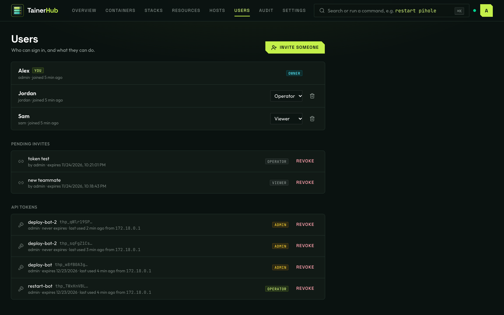

Admins manage users on the **Users** page.

**Inviting someone:**

1. Click **Invite someone**.
2. Pick a role. You can't give out a role higher than your own.
3. Under **Hosts**, keep **All hosts**, or pick **Only some hosts** and tick the hosts they may use (see [Limiting a user to some hosts](#limiting-a-user-to-some-hosts)).
4. Optionally fill in **Who is it for?**, for example "Alex, for the media server".
5. Click **Create invite link**, then **Copy link** and send it however you like.

The link works once, for 24 hours. The person opens it, picks their own username and password (at least 10 characters), and gets their own recovery codes. Unused invites are listed under **Pending invites**, where you can **Revoke** them.

**Changing a role or removing a user:** use the role menu or the remove button on their row. You can only manage users with a lower role than yours, and never your own account. Nobody can change or remove the owner. Removing a user also removes their API tokens.

Each user's row shows the hosts they can use: **All hosts**, or the hosts' names.

Creating invites, changing roles or hosts and removing users need a [recent sign-in](#the-fresh-sign-in-rule). If yours is older than 10 minutes, a **Sign in again to continue** dialog opens.

**API tokens.** Below the users, an **API tokens** section lists the tokens of users ranked below you, and your own (the owner sees every token), with their access level, expiry and when and from where they were last used. **Revoke** stops a token at once. This section only appears when there is at least one token to show.

### Roles

There are four roles. Each one can do everything the role below it can.

| | Viewer | Operator | Admin | Owner |
| --- | :-: | :-: | :-: | :-: |
| See hosts, containers, stacks, images, volumes, networks | ✓ | ✓ | ✓ | ✓ |
| Read container logs | ✓ | ✓ | ✓ | ✓ |
| Manage their own password, passkeys, recovery codes and sessions | ✓ | ✓ | ✓ | ✓ |
| Create and revoke their own API tokens (up to their own role) | ✓ | ✓ | ✓ | ✓ |
| Start, stop, restart, pause, kill and remove containers | | ✓ | ✓ | ✓ |
| Pull & recreate containers; check for image updates | | ✓ | ✓ | ✓ |
| Deploy, pull & redeploy, start, stop, restart and take down saved stacks | | ✓ | ✓ | ✓ |
| Pull and remove images; remove networks; prune images and networks | | ✓ | ✓ | ✓ |
| See environment values, label values, command arguments and health-check output | | | ✓ | ✓ |
| Read and edit compose files and `.env`; create and delete stacks; take over projects | | | ✓ | ✓ |
| Move stacks and standalone containers to another host | | | ✓ | ✓ |
| New container from Docker Hub | | | ✓ | ✓ |
| Delete volumes; prune volumes; remove a container together with its volumes | | | ✓ | ✓ |
| Open a terminal in a container | | | ✓ | ✓ |
| Add, rename and remove hosts; create join tokens | | | ✓ | ✓ |
| Update TainerHub, Docker Engine and OS packages; switch container stats source | | | ✓ | ✓ |
| Invite users, change roles, remove users (lower roles only) | | | ✓ | ✓ |
| See and revoke API tokens of users with a lower role | | | ✓ | ✓ |
| View the audit log | | | ✓ | ✓ |
| Settings (HTTPS and passkeys) | | | ✓ | ✓ |
| Manage admins | | | | ✓ |

The owner is the account created at setup. There is one owner, and nobody else can change or remove it.

A user can also be [limited to some hosts](#limiting-a-user-to-some-hosts). Their role then applies on those hosts only. An admin limited that way can't add, rename or remove hosts, manage users or tokens, open Settings or update TainerHub itself.

These rules are enforced by the hub's API, not just hidden in the UI.

To script TainerHub with an API token, see the [API guide](api.md).

### Limiting a user to some hosts

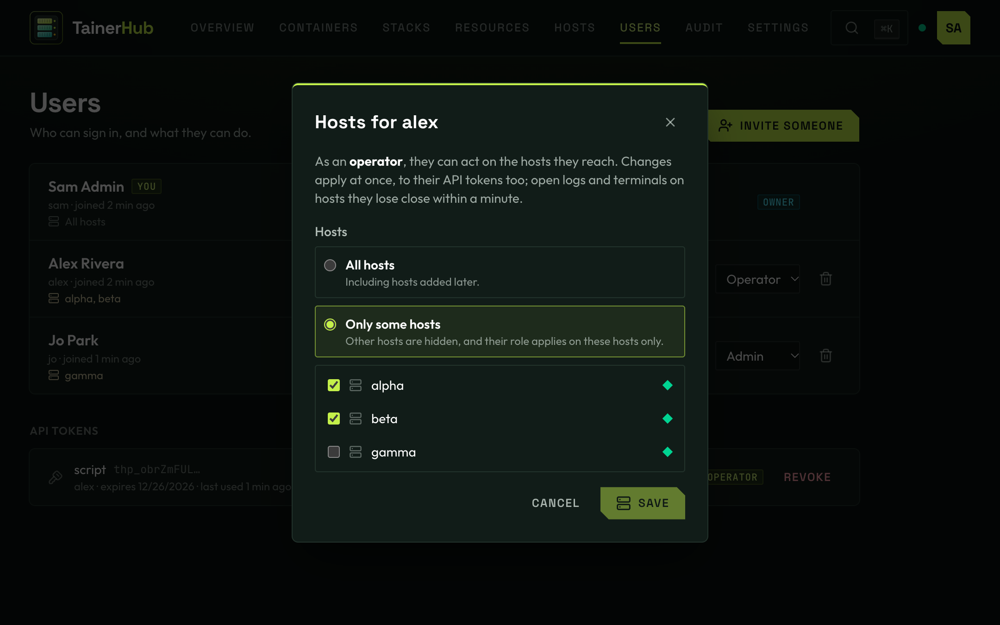

By default everyone can use every host, including hosts added later. To limit someone to some hosts, click **Hosts** on their row, choose **Only some hosts**, tick the hosts and click **Save**. You can also pick hosts when you [invite someone](#users-and-roles). Choose **All hosts** to undo it.

For someone limited to some hosts:

- **They only see their hosts.** Every other host, with its containers, stacks, images, volumes, networks, logs, jobs, updates and activity, is hidden everywhere: the Overview, lists, search, the command palette and host suggestions. Asking the API for another host's things answers `404`, as if it didn't exist.
- **Their role applies on their hosts only.** An operator limited to `nas` can restart containers on `nas`, and nothing anywhere else.
- **Moving a stack or container needs both hosts.** They only see the hosts they could move it to.
- **Their API tokens follow.** A token reaches the same hosts as its owner, and changes to the owner's hosts apply to their tokens at once.
- **Changes apply at once.** Open log streams and terminals on a host they lose close within a minute.
- **The audit log** shows them their own actions and the entries about their hosts only. Entries from before this feature have no hosts recorded, so they only see their own.

**An admin limited to some hosts is a host admin.** They can edit stacks, open terminals, delete volumes, move things between their hosts, and update the agent, Docker Engine and OS packages on their hosts. Hub-wide things stay with admins who have every host: **Users**, **Settings** (HTTPS, passkeys, registry logins, the automatic update window), everyone's API tokens, adding, renaming and removing hosts, and updating TainerHub itself. They get `403` for those.

A host admin can't include the server the hub runs on (marked **hub** in the list): a compose file can mount the whole machine, so root there is root on the hub, and admins see container settings such as the hub's database password. Make them an operator there, or give them every host.

An admin with every host can manage an admin limited to some hosts, as if their role were lower. The owner always has every host.

Changes to someone's hosts are recorded in the [audit log](#audit-log) as **user.hosts_changed**, with the hosts before and after.

## Audit log

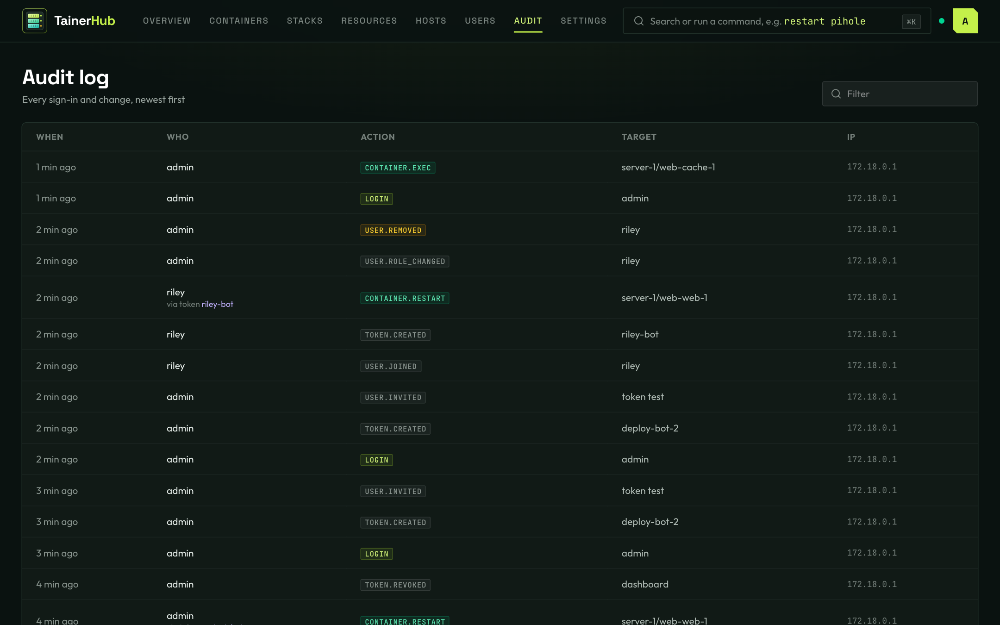

Admins: **Audit**. Every sign-in and change, newest first, with **When**, **Who**, **Action**, **Target** and **IP**. Use **Filter** to search it. The page shows the most recent 500 entries and refreshes itself every 15 seconds.

Actions taken with an API token show **via token** and the token's name under the user, so you can tell a script from a person.

It records, among other things:

- sign-ins (with the method: password, passkey or recovery code) and failed sign-ins,
- password, passkey and recovery-code changes, and "sign out other sessions",
- container and stack actions, with any error,
- stack creation, edits and deletion,
- terminal sessions,
- hosts added, renamed, removed, enrolled and their certificates renewed,
- TainerHub, Docker Engine and OS package updates, and stats-source changes,
- users invited, joined, changed (role or hosts) and removed,
- API tokens created and revoked,
- HTTPS turned on or off.

Failed sign-ins that hit the rate limit aren't logged, so a flood of attempts can't fill the log.

The hub deletes entries older than 365 days. To change that, set `TAINERHUB_AUDIT_RETENTION_DAYS` on the `tainerhub` service in the hub's compose file (`0` keeps them forever) and run `docker compose up -d`.

## Settings

Admins: **Settings**. This page sets up HTTPS and passkeys through a reverse proxy. It shows whether HTTPS is on, whether passkeys are on, and walks you through four steps. Turning HTTPS on or off needs a [recent sign-in](#the-fresh-sign-in-rule). See [HTTPS and passkeys](https-and-passkeys.md).

## Account

Everyone: account menu → **Account & sign-in**. It shows your username and role, and has five cards.

- **Password.** Change it with your current password and a new one (at least 10 characters). If you signed up with passkeys only, you can **Set password** to have a second way in. Changing or setting a password signs out your other sessions.
- **Passkeys.** Add a passkey for each device you use: Touch ID, Windows Hello, your phone or a security key. Name it (for example "iPhone") and click **Add**. Passkeys need HTTPS, so this only works at TainerHub's secure address; on the LAN address the card links you there. You can remove a passkey, except your only one when you have no password.
- **Recovery codes.** How many unused codes you have left. It turns red at 3 or fewer. **Generate new codes** makes 10 new ones and cancels the old ones at once.
- **API tokens.** Tokens that let scripts and tools use the API as you. See [API tokens](#api-tokens) below.
- **Other sessions.** **Sign out other sessions** signs out every other browser and device. This browser stays signed in. It doesn't revoke API tokens.

### API tokens

Under **API tokens**, **Create a token**:

1. Name it after what will use it, for example `grafana-dashboard` or `backup script`.
2. Pick its **Access**: **viewer**, **operator** or **admin**, up to your own role (the owner can also pick **owner**).
3. Pick when it **Expires**: **30 days**, **90 days** (the default), **1 year** or **Never**.
4. Click **Create**.

The dialog that opens shows the token (`thp_...`) **once**, with **Copy token** and a ready-made `curl` command to try it. Keep it in a password manager or your script's secrets.

The list shows each token's name, the start of the token, its access level, when it expires, and when and from which IP address it was last used. The bin button (**Revoke**) revokes it after you confirm. Anything using it stops working at once.

A token never does more than its access level, or more than your current role: if you're made a viewer, your admin token acts as a viewer. Tokens can't invite users, change roles, change how anyone signs in, add hosts, turn HTTPS on or off, or create or revoke tokens. Creating a token needs a [recent sign-in](#the-fresh-sign-in-rule).

How to call the API, and every endpoint, is in the [API guide](api.md).

### The fresh sign-in rule

Some changes could give someone who stole your session lasting access. They need a sign-in from **the last 10 minutes**:

- adding or removing a passkey, generating new recovery codes, and setting a first password,
- creating an API token,
- creating invites, changing roles and removing users,
- adding a host and making a new join token,
- turning HTTPS on or off.

If your sign-in is older, TainerHub asks you to **Sign in again to continue** (a card on the Account page, a dialog elsewhere). Click **Sign in again**, sign in, and you come back to the same page. Then try once more.

Changing an existing password doesn't need this, because you type your current password instead.

### Signing in with a recovery code

On the sign-in page, click **Use a recovery code**, enter your username and one code (`XXXX-XXXX-XXXX`), and click **Sign in**. TainerHub takes you to your Account page so you can set a new password or passkey. Each code works once.

## Command palette

Press `⌘K` (Mac), `Ctrl+K` (Windows and Linux) or `/` anywhere, or click the search box at the top. Type to search pages, containers and hosts. Use the arrow keys to move and `Enter` to run. `Esc` closes it.

Start with a verb to act on a container straight away:

| Type | Does |
| --- | --- |
| `restart pihole` | Restarts the container named pihole. |
| `logs npm` | Opens npm's logs. |
| `stop mosquitto` | Stops mosquitto. |
| `stop server-2/mosquitto` | Stops mosquitto on server-2, when several hosts have one. |
| `details grafana` | Opens grafana's details panel. |

The verbs are `start`, `stop`, `restart`, `pause`, `unpause`, `kill`, `remove`, `logs` and `details`. Matching uses the host name, container name and image. Actions that change things ask for confirmation just like the buttons do, and need the operator role. Viewers can use `logs` and `details`.

## Phone layout

&nbsp;&nbsp;
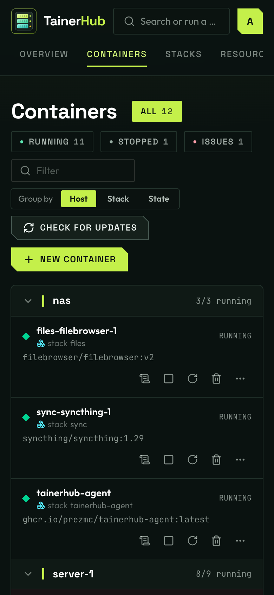

TainerHub works in a phone's browser. The menu becomes a row you can swipe sideways, below the logo and search box. Two-column pages such as the Overview stack into one column, and the Containers list shows each container as a card with its action buttons underneath.

Everything else works as on a computer, including logs and the command palette (tap the search box). To reach TainerHub from outside your home network, use a VPN or [HTTPS through your reverse proxy](https-and-passkeys.md); don't expose port 8585.
