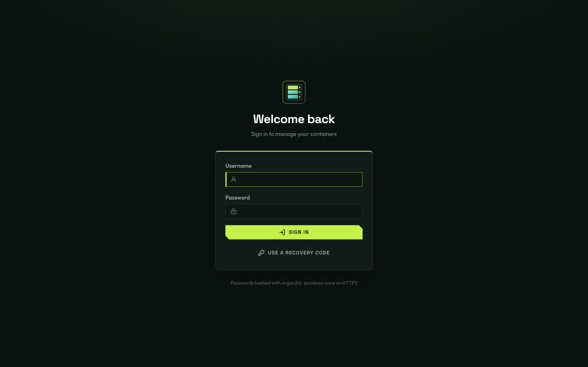
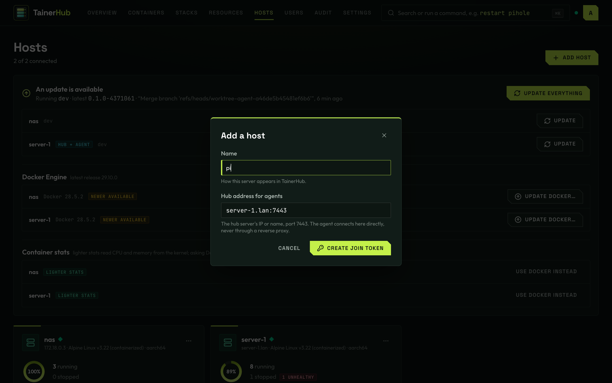

# Getting started

This guide takes you from nothing to a working TainerHub that manages all your Docker servers.

TainerHub has two parts:

- **The hub.** The web UI, the API and a small Postgres database. You run one.
- **The agent.** A small container on every Docker server you want to manage. Each agent connects *out* to the hub, so managed servers don't need any open ports.

The hub's compose file already includes an agent for its own server, so that server is managed from the start.

## Requirements

- A Linux server with Docker Engine and the Docker Compose plugin (`docker compose version` must work).
- Shell access as root, or as a user in the `docker` group.
- `curl` or `wget`, for the one-line installer.
- Other servers you want to manage need Docker and the Compose plugin too, and must be able to reach the hub on port 7443.
- Outbound internet access from the servers, to pull images from `ghcr.io` and Docker Hub. The hub also asks GitHub for the newest TainerHub and Docker Engine versions.

## 1. Install the hub

### One-line installer

On the server that will run the hub:

```bash
curl -fsSL https://raw.githubusercontent.com/prezmc/tainerhub/main/install.sh | sh
```

The script:

1. Checks that Docker and the Compose plugin work.
2. Downloads the hub's `compose.yml` into `~/tainerhub`. It never overwrites a `compose.yml` that is already there.
3. Pulls the images and runs `docker compose up -d`.
4. Waits up to 2 minutes for the hub to report healthy.
5. Prints the database password and your one-time setup link.

It's safe to run again. If setup isn't finished, it just prints a fresh link.

Two optional environment variables change its defaults:

| Variable | What it does |
| --- | --- |
| `TAINERHUB_DIR` | Install somewhere other than `~/tainerhub`. |
| `TAINERHUB_HOST` | The address to print in the setup link, if the script guesses the wrong IP. |

### By hand

The installer only does this:

```bash
mkdir -p ~/tainerhub && cd ~/tainerhub
curl -fsSLO https://raw.githubusercontent.com/prezmc/tainerhub/main/deploy/hub/compose.yml
docker compose up -d
docker exec tainerhub /tainerhub db-password   # save this
docker exec tainerhub /tainerhub setup-link    # open http://<server IP>:8585 + what this prints
```

The compose file starts three containers:

| Container | What it is |
| --- | --- |
| `tainerhub` | The hub: web UI and API on port 8585, agent gateway on port 7443. |
| `tainerhub-agent` | The agent for this server. It enrolls itself with the hub. |
| `tainerhub-postgres` | The database. It sits on an internal Docker network that only the hub can reach. |

## 2. Save the database password

Postgres starts with a well-known default password. On first start the hub replaces it with a random one and saves it in its `/data` volume. You won't need it day to day. Save a copy in your password manager in case you ever restore the database without that volume.

```bash
docker exec tainerhub /tainerhub db-password
```

It is never written to the logs.

Want to choose the password yourself? Put `DB_PASSWORD=...` in a `.env` file next to the hub's `compose.yml` **before the first start**. The hub then leaves it alone, and `db-password` has nothing to show.

## 3. Create your account

Open the setup link the installer printed, for example:

```
http://192.168.1.10:8585/setup?token=...
```

The link works for 15 minutes. Lost it, or too late? Print a fresh one:

```bash
docker exec tainerhub /tainerhub setup-link
```

It prints only the path (`/setup?token=...`). Add it to `http://<server IP>:8585`, or open `http://<server IP>:8585` and paste it into the **Setup link or token** box.

On **Create your account**:

1. Pick a username (for example `admin`) and an optional display name.
2. Pick a password of at least 10 characters.
3. Click **Create account**.

This first account is the **owner**. TainerHub then shows 10 recovery codes. Save them somewhere safe, outside TainerHub. Each one signs you in once if you lose your password. Click **I've saved them, continue**.



You now sign in with your username and password over plain HTTP. That's fine on a home network. To add HTTPS and passkeys later, see [HTTPS and passkeys](https-and-passkeys.md).

> **Plain HTTP is for your LAN only.** Until you set up HTTPS, passwords and session cookies cross the network unencrypted. Don't expose port 8585 to the internet.

## 4. Add your other servers

The hub's own server shows up under **Hosts** a few seconds after the hub starts. For each other server:

1. Go to **Hosts** and click **Add host**.
2. Enter a **Name** (for example `server-2` or `nas`). This is only how it appears in TainerHub.
3. Check **Hub address for agents**. It is pre-filled with the address you opened TainerHub on, port 7443, for example `192.168.1.10:7443`. Change it if the new server should reach the hub by another IP or name. This must be the hub itself, never a reverse proxy.
4. Click **Create join token**.



TainerHub shows a one-line command. Paste it into a terminal on the new server, as root or a user in the `docker` group:

```bash
curl -fsSL "http://192.168.1.10:8585/join/<one-time token>?hub=192.168.1.10:7443" | sh
```

The command:

1. Checks that Docker and the Compose plugin work.
2. Stops if a container called `tainerhub-agent` already exists on that server.
3. Writes the agent's `compose.yml` into `~/tainerhub-agent` (an existing one is kept as a `.bak` copy).
4. Starts the agent and waits up to 90 seconds for it to connect.

The host turns green in TainerHub when it's connected.

The link works **once** and expires **one hour** after you created it. If it expires, open the host's menu (the `…` button on its card) and pick **New join token**.

The new server must be able to reach two addresses: the hub's port 7443 (where the agent connects) and the address you opened TainerHub on (to download the installer).

### Setting up the agent by hand

Prefer not to pipe a script into `sh`? In the same dialog, open **Set it up by hand instead**. It shows the agent's compose file with the join token filled in. Save it as `~/tainerhub-agent/compose.yml` on the new server and run `docker compose up -d` in that folder.

The generated file looks like this:

```yaml
services:
  tainerhub-agent:
    image: ghcr.io/prezmc/tainerhub-agent:latest
    container_name: tainerhub-agent
    restart: unless-stopped
    read_only: true
    security_opt: ["no-new-privileges:true"]
    cap_drop: [ALL]
    healthcheck:
      test: ["CMD", "/tainerhub-agent", "healthcheck"]
      interval: 30s
      timeout: 5s
      retries: 3
    volumes:
      - /var/run/docker.sock:/var/run/docker.sock
      - tainerhub-agent:/data
      # Compose stacks. Keep the same path on both sides (relative bind mounts).
      - /opt/tainerhub/stacks:/opt/tainerhub/stacks
      # Read-only: lets the agent read container CPU and memory from the kernel,
      # which costs the server far less than asking Docker. Optional.
      - /sys/fs/cgroup:/host/sys/fs/cgroup:ro
    environment:
      TAINERHUB_HUB: 192.168.1.10:7443
      # One-time token, valid for 1 hour. It can be removed after the first start.
      TAINERHUB_JOIN_TOKEN: thj1_...
volumes:
  tainerhub-agent:
```

What each volume is for:

- **`/var/run/docker.sock`**: how the agent talks to Docker on that server.
- **`tainerhub-agent:/data`**: the agent's certificate. Keep this volume, or the agent has to enroll again.
- **`/opt/tainerhub/stacks`**: where [stacks](features.md#stacks) are written. It must be the same path on both sides.
- **`/sys/fs/cgroup` (read-only)**: lets the agent read CPU and memory from the kernel instead of asking Docker. Optional, but lighter on the server.

## 5. Open the right ports

| Port | On | Who needs to reach it |
| --- | --- | --- |
| 8585 | the hub | Your browser (or your reverse proxy, once you add HTTPS). Also each new server, once, to download the agent installer. |
| 7443 | the hub | Every agent. Always directly, **never through a reverse proxy**. |

Managed servers open no ports. Their agents connect out to the hub.

Port 7443 uses mutual TLS. A reverse proxy would end the TLS connection and strip the agents' client certificates, so agents must reach the hub directly: by LAN IP, a LAN name or a VPN address. Agents trust the hub by its private certificate authority, not by hostname, so any address that reaches it works.

Docker-published ports bypass `ufw`. If you want to limit who can reach 8585 or 7443, use the `DOCKER-USER` iptables chain. For example, once everyone uses HTTPS through a proxy at `192.168.1.20`, this blocks port 8585 from everything else:

```bash
sudo iptables -I DOCKER-USER -p tcp -m conntrack --ctorigdstport 8585 ! -s 192.168.1.20 -j DROP
```

Rules added like this don't survive a reboot unless you save them with your distribution's tooling.

## 6. Keep TainerHub up to date

Each green build of TainerHub's `main` branch publishes new images. The hub checks GitHub for the newest one. Admins see the result in a card at the top of **Hosts**:

- **Update** on a server's row updates that server's TainerHub containers.
- **Update everything** updates the other servers first and the hub's own server last.

Only TainerHub's own containers are recreated. Your other containers aren't touched. When the hub's server is updated, the hub restarts and the page reconnects and reloads by itself, usually within a minute or two.

How it works: the agent on each server starts a short-lived helper container that runs `docker compose up -d --pull always` for the compose project the agent belongs to, then removes itself. On the hub's server that project is `~/tainerhub`, so the hub and its database are updated too.

If the hub was installed without its built-in agent, it can't update itself. The card tells you to run this on its server:

```bash
cd ~/tainerhub && docker compose pull && docker compose up -d
```

Updating by hand works the same everywhere: run `docker compose pull && docker compose up -d` in `~/tainerhub` and in each `~/tainerhub-agent`.

The same card can also update **Docker Engine** on each server. See [Hosts](features.md#hosts).

## 7. Turn on lighter stats (older installs)

Agents can read container CPU and memory straight from the kernel's cgroup files. This costs the server much less than asking Docker. New installs already have the read-only `/sys/fs/cgroup` mount that makes this possible.

Installs from before that mount was added still ask Docker. After updating, the **Container stats** section of the Hosts update card shows **Turn on lighter stats** for those servers. Clicking it:

- writes a `compose.override.yml` next to the agent's compose file, adding the read-only mount, and
- restarts only the agent.

Your other containers, and the hub, aren't touched.

If a `compose.override.yml` that TainerHub didn't write is already there, it won't change it. Add this line under the agent's `volumes:` yourself, then run `docker compose up -d`:

```yaml
      - /sys/fs/cgroup:/host/sys/fs/cgroup:ro
```

Lighter stats need cgroup v2. Without the mount, or on cgroup v1, the agent asks Docker instead.

## 8. Uninstall

**A managed server.** First remove it in TainerHub: **Hosts**, the host's `…` menu, **Remove host**. Its certificate stops working at once. Then, on the server:

```bash
cd ~/tainerhub-agent && docker compose down -v
```

`-v` deletes the agent's certificate volume. Your other containers keep running. Stack folders in `/opt/tainerhub/stacks` are left in place; delete them yourself if you no longer need them.

**The hub.** On the hub's server:

```bash
cd ~/tainerhub && docker compose down       # stop it, keep the data
cd ~/tainerhub && docker compose down -v    # stop it and delete all its data
```

`down -v` deletes the database, the hub's certificate authority and the database password. There is no undo. Every agent would have to enroll again with a new hub.

## Next steps

- [Features](features.md): a tour of every page.
- [HTTPS and passkeys](https-and-passkeys.md): put TainerHub behind Nginx Proxy Manager.
- [Security](security.md): how TainerHub protects your servers, and a hardening checklist.
- [Troubleshooting](troubleshooting.md): common problems and fixes.
