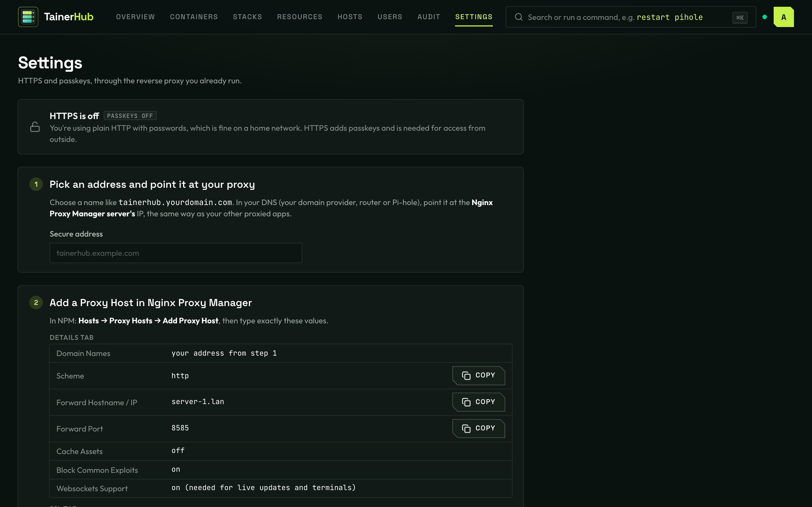

# HTTPS and passkeys

Out of the box, TainerHub runs over plain HTTP on port 8585 and you sign in with a password. That's fine on a home network. Add HTTPS when you want:

- **passkeys** (Touch ID, Windows Hello, your phone or a security key), which need HTTPS, or
- **access from outside** your network.

TainerHub doesn't get certificates itself. You put it behind the reverse proxy you already run. This guide uses Nginx Proxy Manager (NPM), and the Settings page has NPM's exact field names. Any reverse proxy works if it forwards the same way.

It all happens in the browser, with no restart: **Settings** (admins only).



## What you need

- A domain name you control, or a local DNS server (your router, Pi-hole or similar) where you can add a record.
- Nginx Proxy Manager, on its own server or on the hub's server.
- NPM must be able to reach the hub on port 8585.
- The hub must be able to reach NPM on port 443 at your chosen address. The hub tests the setup by calling itself through the proxy.

## Step 1: Pick an address and point it at your proxy

Choose a name like `tainerhub.example.com`. In your DNS (your domain provider, router or Pi-hole), point it at the **Nginx Proxy Manager server's** IP, the same way as your other proxied apps.

Type the name into **Secure address** on the Settings page. You can leave out `https://`.

Passkeys are tied to this exact address. If you change it later, passkeys made for the old one stop working. Pick a name you'll keep.

## Step 2: Add a Proxy Host in Nginx Proxy Manager

In NPM, go to **Hosts → Proxy Hosts → Add Proxy Host**. Settings shows the exact values, with copy buttons. They are:

**Details tab**

| Field | Value |
| --- | --- |
| Domain Names | your address from step 1, e.g. `tainerhub.example.com` |
| Scheme | `http` |
| Forward Hostname / IP | the hub server's LAN IP, e.g. `192.168.1.10` |
| Forward Port | `8585` |
| Cache Assets | off |
| Block Common Exploits | on |
| Websockets Support | on or off (TainerHub streams without websockets) |
| Access List | Publicly Accessible, or one that allows only your networks (see [Keeping it LAN-only](#keeping-it-lan-only)) |

**SSL tab**

| Field | Value |
| --- | --- |
| SSL Certificate | Request a new SSL Certificate (Let's Encrypt), or pick your wildcard certificate |
| Force SSL | on |
| HTTP/2 Support | on |
| HSTS Enabled | on |

Settings pre-fills the forward host with the address you opened TainerHub on. If you opened it as `localhost`, use the server's LAN IP instead, so NPM can reach it.

**Only port 8585 goes through the proxy.** Agents connect to the hub on port 7443 directly. Never add 7443 to NPM: the proxy would end the TLS connection and strip the agents' client certificates.

## Step 3: Test it from the hub

Click **Test tainerhub.example.com**. The hub requests `https://tainerhub.example.com/api/https-check` with a one-time code, and checks that the request comes back to *this* hub through the proxy. The test takes up to about 12 seconds.

A passing test shows:

- The address reaches this TainerHub through the proxy (proxy IP `192.168.1.20`).
- The certificate is valid.
- The proxy tells TainerHub the visitor used HTTPS.

The test also notes the IP address the request came from. That's your proxy's IP, which you need in step 4.

If something fails, see [Troubleshooting](#troubleshooting) below.

## Step 4: Turn on HTTPS

After a test that reached the hub through the proxy, or that failed only on the certificate, a fourth step appears.

**Proxy IP (trusted)** is filled in with the address the test saw. TainerHub trusts this IP, and only this IP, to say two things about each visitor: their real IP address (`X-Forwarded-For`) and that they used HTTPS (`X-Forwarded-Proto`). The real IP matters for the sign-in rate limit and the audit log.

It's required: without it TainerHub can't see visitors' real IPs (so one person guessing passwords would lock everyone out) or that they used HTTPS (so cookies wouldn't be marked `Secure`).

Keep it to **your proxy's single IP**. You can enter several addresses separated by commas, or a range, but:

- A range trusts every address in it. Settings warns you: "Every address in this range will be trusted to report visitors' IPs and HTTPS." Use one only if your proxy's address changes.
- Ranges wider than `/16` (IPv4) or `/48` (IPv6) are refused, for example `10.0.0.0/8` or `0.0.0.0/0`. Anything in such a range could pretend to be any visitor and dodge the sign-in limit.

Then click **Turn on HTTPS**. It applies straight away, with no restart:

- Passkeys switch on.
- The `https://` address gets cookies marked `Secure` with the `__Host-` prefix.
- The LAN address (`http://192.168.1.10:8585`) keeps working with passwords. You can always turn HTTPS off from there.

You have 15 minutes after a passing test to turn it on. After that, test again.

Turning HTTPS on or off needs a sign-in from the last 10 minutes. If yours is older, a **Sign in again to continue** dialog opens; sign in, and you come back to Settings.

If the test didn't fully pass, the button is **Turn on anyway** instead. It asks you to confirm, because browsers may refuse passkeys on that address until the certificate is fixed.

## Step 5: Add passkeys

1. Open the secure address, for example `https://tainerhub.example.com`. If you're on the LAN address, Settings has an **Open secure address** button.
2. Sign in with your password.
3. Go to account menu → **Account & sign-in**.
4. Under **Passkeys**, name the device (for example "iPhone") and click **Add**.

Adding a passkey needs a sign-in from the last 10 minutes. If you see **Sign in again to continue**, sign in again and retry.

Register a passkey on each device you use. Until you add one, everyone sees a banner: "Passkeys are available now: add one for faster, phishing-proof sign-in."

The sign-in page at the secure address now shows **Sign in with passkey**, with the password form below it. Passwords and recovery codes keep working.

## Step 6: Require passkeys on the secure address

Once your admins have passkeys, turn on **Accounts with a passkey must use it on the secure address** in Settings. Then nobody can guess their way into those accounts through the proxy: a password sign-in there is refused for any account with a passkey. Recovery codes still work, accounts without a passkey keep their password (so they can add one), and passwords keep working on the LAN address. Do this before opening TainerHub to the internet; see [Security: Opening TainerHub to the internet](security.md#opening-tainerhub-to-the-internet).

## Keeping it LAN-only

HTTPS doesn't have to mean "on the internet". To use passkeys at home without exposing TainerHub:

- **Use an NPM Access List.** In NPM, create an Access List that allows only your LAN range (for example `192.168.1.0/24`) and denies everything else, then select it on the TainerHub proxy host. Include every network you add servers from (other subnets, VLANs, VPN), or download their installer from the hub directly (see [Add your other servers](getting-started.md#4-add-your-other-servers)). Otherwise the install command fails with `403`.
- **Or use split DNS.** Give `tainerhub.example.com` a record only in your local DNS (router or Pi-hole), pointing at NPM's LAN IP. Outside your network, the name doesn't resolve. Let's Encrypt can still issue a certificate if NPM uses a DNS challenge with your DNS provider, or use a wildcard certificate you already have.
- **Don't forward port 8585 or 443 to TainerHub on your router** unless you mean to.

Once everyone uses the `https://` address, you can stop port 8585 being reachable from anything except the proxy. Docker-published ports bypass `ufw`, so use the `DOCKER-USER` chain. With the proxy at `192.168.1.20`:

```bash
sudo iptables -I DOCKER-USER -p tcp -m conntrack --ctorigdstport 8585 ! -s 192.168.1.20 -j DROP
```

Note that this also stops the LAN fallback address from working, and new servers then need the agent installer from the `https://` address. Rules added like this don't survive a reboot unless you save them.

## Setting it in the compose file instead

If you'd rather keep this in the compose file, set both values on the `tainerhub` service in `~/tainerhub/compose.yml`:

```yaml
    environment:
      TAINERHUB_PUBLIC_URL: https://tainerhub.example.com
      TAINERHUB_TRUSTED_PROXIES: 192.168.1.20
```

Then run `docker compose up -d`.

The compose file takes priority and **locks the Settings page**: it shows "set in compose file", and you can't test, turn on or turn off HTTPS there. To manage it from Settings again, remove `TAINERHUB_PUBLIC_URL` and run `docker compose up -d`.

`TAINERHUB_TRUSTED_PROXIES` takes IPs or ranges, separated by commas. Don't leave it out: the hub starts without it but logs a warning, and Settings shows one too, naming the proxy address it sees. While `TAINERHUB_PUBLIC_URL` is set, the address and proxy saved in Settings are ignored. Unlike Settings, a too-broad range here is still applied (so an existing install keeps starting), but the hub logs a warning. Use your proxy's own IP.

## Turning it off

On Settings, click **Turn off** and confirm.

- Passkeys stop working until you turn HTTPS back on. They are kept, not deleted.
- Everyone can still sign in with a password at the LAN address.
- Your proxy keeps forwarding. Remove its proxy host in NPM if you no longer want it.

If HTTPS was set in the compose file, there's no Turn off button. Remove the environment variables instead.

## Troubleshooting

### The test message says...

| Message | What to check |
| --- | --- |
| "... doesn't resolve from the hub. Add a DNS record pointing it at your proxy" | The hub's server can't look up the name. Add the DNS record, and make sure the hub's server uses that DNS server. |
| "Nothing answered on ... port 443. Is the proxy running, and does the DNS record point at it?" | NPM isn't running, or the name points at the wrong machine, or a firewall blocks 443 from the hub. |
| "... didn't answer in time. Check DNS and that the proxy is reachable from the hub's server." | Usually a firewall dropping traffic, or a public IP the hub can't reach from inside your network (see "hairpin" below). |
| "The proxy answered but couldn't reach TainerHub (HTTP 502...)" | NPM's **Forward Hostname / IP** or **Forward Port** is wrong, or NPM can't reach port 8585 on the hub. |
| "The proxy redirected the request (HTTP 3xx...)" | **Scheme** should be `http`, and the forward port the hub's (8585). |
| "The proxy answered HTTP 404 ..." (or another status) | The proxy host doesn't point at this hub, or the domain name in NPM doesn't match. |
| "... answered, but not as this TainerHub." | The address reaches a different app or a different TainerHub. Check the forward host and port. |
| "... points at this server itself or a reserved address, which can't be a reverse proxy." | The name resolves to `127.0.0.1`, a link-local address or similar. Point it at your proxy's LAN or public IP. |
| "The certificate isn't trusted (...)" | Request a Let's Encrypt certificate for this exact name in NPM's SSL tab, or pick a wildcard certificate that covers it. Everything else is still checked, so you'll see whether the rest works. |
| "The proxy didn't send X-Forwarded-Proto: https." | NPM sends this on its own. Another proxy needs to be told to set it. |

### The address opens a different app

If `https://tainerhub.example.com` shows another service, or NPM's default page:

- The DNS record points at the wrong machine, or at a different proxy.
- The **Domain Names** field in NPM has a typo, so NPM falls back to its default site.
- Your browser or the hub's server cached an old DNS answer. Wait a few minutes, or flush the cache.

The test catches this: it fails with "answered, but not as this TainerHub" or an HTTP error.

### Certificate errors in the browser

- Let's Encrypt couldn't issue the certificate. Check NPM's SSL tab for an error. An HTTP challenge needs port 80 reachable from the internet; for a LAN-only name, use a DNS challenge.
- The certificate is for a different name. A wildcard `*.example.com` covers `tainerhub.example.com` but not `tainerhub.home.example.com`.

### It works from outside but the test times out (hairpin)

The hub tests from its own server. If your DNS gives a public IP and your router doesn't support "hairpin NAT", requests from inside your network to your own public IP go nowhere. Add a local DNS record pointing the name at NPM's LAN IP (split DNS).

### Passkeys aren't offered

See [Troubleshooting: passkeys not offered](troubleshooting.md#passkeys-arent-offered).
